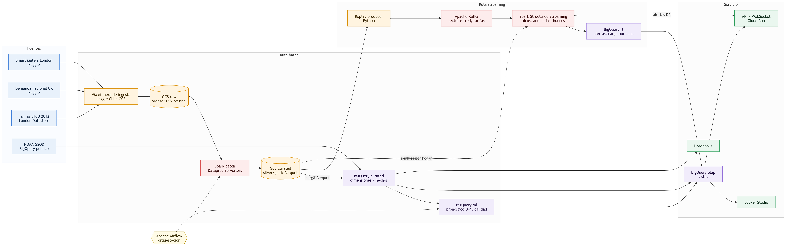

# DataEnergía Metropolitan · Lumina Energía

Arquitectura Big Data para una red eléctrica inteligente (Smart Grid), desarrollada como taller del curso de Big Data (UTEC). Cubre las cuatro verticales del caso:

1. **Decisiones en tiempo real**: replay de lecturas de medidores → Kafka → Spark Structured Streaming (picos y anomalías).
2. **Planes diarios de demanda**: batch con Spark y pronóstico de demanda del día siguiente.
3. **Informes operativos (OLAP)**: vistas en BigQuery para Looker Studio.
4. **Mantenimiento predictivo**: calidad de medidores, huecos de telemetría y consumos anómalos.



El enunciado está en [docs/Taller_Arquitectura_BigData_DataEnergia.qmd](docs/Taller_Arquitectura_BigData_DataEnergia.qmd) y el plan de arquitectura, con la justificación técnica y económica, en [docs/00_plan_arquitectura.md](docs/00_plan_arquitectura.md).

## Stack

Google Cloud con un presupuesto máximo de US$300, priorizando código abierto: Apache Kafka, Apache Spark (Managed Service for Apache Spark, ex Dataproc Serverless), Apache Airflow y Parquet sobre GCS, con BigQuery como data warehouse.

## Datos

| Dataset | Fuente |
|---|---|
| Smart Meters in London | [Kaggle · jeanmidev](https://www.kaggle.com/datasets/jeanmidev/smart-meters-in-london) |
| Demanda eléctrica nacional UK 2009-2022 | [Kaggle · albertovidalrod](https://www.kaggle.com/datasets/albertovidalrod/electricity-consumption-uk-20092022) |
| NOAA GSOD | BigQuery público (`bigquery-public-data.noaa_gsod`) |

Los datos no se versionan: se descargan a GCS con `infra/04_ingesta_kaggle.sh`.

## Estructura

```
infra/       gcloud/bq: presupuesto, buckets, datasets, VMs, apagado y teardown
src/
  ingestion/ Kaggle → GCS
  batch/     jobs PySpark (limpieza, modelo de datos, perfiles)
  streaming/ replay producer + Spark Structured Streaming
  dags/      DAGs de Airflow
  sql/       vistas OLAP y modelos
notebooks/   EDA, pronóstico y calidad de medidores
docs/        enunciado, plan, diagramas y slides
```

## Cómo empezar

Requisitos: [Google Cloud CLI](https://cloud.google.com/sdk/docs/install) autenticado, Bash (en Windows, Git Bash) y una cuenta de Kaggle.

```bash
cp infra/config.example.env infra/config.env   # completar PROJECT_ID, BILLING_ACCOUNT y KAGGLE_API_TOKEN
bash infra/01_apis_presupuesto.sh              # APIs + presupuesto con alertas US$50/150
bash infra/02_buckets_bigquery.sh              # buckets raw/curated + datasets BigQuery

bash infra/03_secreto_kaggle.sh               # KAGGLE_API_TOKEN de config.env → Secret Manager
bash infra/04_ingesta_kaggle.sh                # VM efímera: Kaggle → gs://<proyecto>-lumina-raw
```

## Control de costos

```bash
bash infra/shutdown.sh    # al final de cada sesión: apaga VMs y cancela jobs, conserva los datos
bash infra/teardown.sh    # al final del curso: borra todos los recursos (pide confirmación)
```

## Autoría

Piero Palacios · Curso de Big Data, UTEC.
Desarrollado con asistencia de IA generativa (Claude); las decisiones técnicas y las cifras de costo deben validarse con el docente y con la calculadora de precios de GCP.
