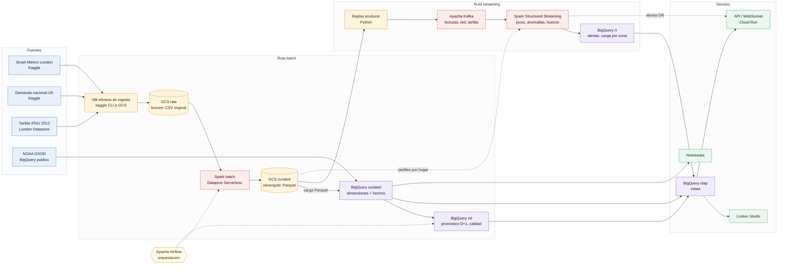

# Fase 0 – Plan de arquitectura · DataEnergía Metropolitan (Lumina Energía)

> Borrador generado con asistencia de IA (Claude). Validar precios en la calculadora de GCP y decisiones técnicas con el docente.
> Precios de referencia us-central1, octubre 2026.

## 1. Estilo de arquitectura

**Lakehouse con medallion (bronze → silver → gold) + ruta de streaming tipo Kappa.**

- El histórico (Kaggle, NOAA) entra por lotes al *data lake* en GCS y se cura con Spark a Parquet.
- El "tiempo real" es un *replay* de `halfhourly_dataset` hacia Kafka; Spark Structured Streaming detecta picos y anomalías usando los perfiles aprendidos en batch (el batch alimenta al streaming, el streaming alimenta al warehouse).
- BigQuery es la capa *gold* / OLAP (vistas para Looker Studio, modelos de pronóstico).
- Todo el cómputo es efímero: VM que se apaga, Spark serverless por trabajo.

## 2. Diagrama


Fuente editable: [diagrama_arquitectura.mmd](diagrama_arquitectura.mmd) (también en SVG para las slides).



## 3. Fuentes de datos clasificadas

| Fuente | Clase | Velocidad | Volumen aprox. | Entrada |
|---|---|---|---|---|
| `halfhourly_dataset` (LCLid, tstp, kWh) | IoT / medidores | 30 min (→ 1 min) | ~167 M filas, ~10 GB CSV | Batch histórico **y** replay a Kafka |
| `daily_dataset` | IoT agregado | diaria | ~3.5 M filas | Batch (validación cruzada del agregado propio) |
| `informations_households`, `acorn_details` | Referencia / maestros | casi estática | KB | Batch → dimensiones |
| `uk_bank_holidays` | Referencia / calendario | anual | KB | Batch → `dim_fecha` |
| DarkSky horario/diario | Externa · clima | horaria | MB | Batch + replay `weather.current` |
| NOAA GSOD (Heathrow, stn 037720) | Externa · clima (warehouse público) | diaria | MB consultados | SQL directo en BigQuery |
| Demanda nacional UK 2009-2022 | Externa · red | 30 min | ~230 k filas | Batch + replay `grid.demand` |
| Eventos de tarifa dToU 2013 | Externa · precio | eventos | KB | Batch + replay `tariff.events` |

## 4. Componentes y justificación

| # | Componente | Rol | Por qué este y no otro |
|---|---|---|---|
| 1 | **GCS** (2 buckets: `raw`, `curated`) | Data lake bronze/silver/gold, checkpoints de streaming | Almacenamiento desacoplado del cómputo, US$0.020/GB-mes; formato abierto (Parquet) = sin *lock-in*, requisito Lumina. |
| 2 | **VM efímera de ingesta** | Descarga Kaggle → GCS sin pasar por la laptop | Ingress a GCP es gratis; se borra al terminar (~1 h). |
| 3 | **Apache Spark en Dataproc Serverless** | Limpieza de ~167 M lecturas, modelo estrella, perfiles por hogar | Spark es open source; serverless = se paga solo mientras corre el *batch* (sin clúster encendido). |
| 4 | **Parquet particionado por fecha** (Iceberg opcional) | Formato silver/gold | Columnar y comprimido (~10 GB CSV → ~1.5–2 GB); BigQuery lo carga gratis. Iceberg aporta ACID/*time travel* si se quiere mostrar. |
| 5 | **Apache Kafka (KRaft, 1 broker)** en VM | Bus de eventos: lecturas, demanda de red, eventos de tarifa, alertas | Open source (requisito RFP), particionado por `LCLid` para escalar a 1 lectura/min. Pub/Sub queda como alternativa gestionada. |
| 6 | **Spark Structured Streaming** (misma VM) | Picos por zona/segmento, anomalías por medidor, huecos de telemetría, señales de respuesta a la demanda | Mismo motor que el batch (un solo código/skillset); *watermarks* y estado para detectar medidores que dejan de reportar. |
| 7 | **Apache Airflow** (misma VM, LocalExecutor) | Orquestación de DAGs batch, carga a BQ y reentrenamiento | Open source, sustituye a Cloud Composer (~US$300+/mes, fuera de presupuesto). |
| 8 | **BigQuery** | Warehouse OLAP, tablas `curated`, `rt`, `ml`, `olap` | Free tier 10 GB almacenamiento + 1 TB consultas/mes; NOAA GSOD ya está ahí (cruce lake ↔ warehouse público). |
| 9 | **Modelos** | Pronóstico D+1 por zona/segmento (Spark MLlib / LightGBM, baseline BQML ARIMA_PLUS); calidad de medidores (reglas + z-score robusto + Isolation Forest) | Prioriza open source; BQML solo como *benchmark* barato sobre datos agregados (MB). |
| 10 | **Looker Studio** | Dashboards de informes operativos | Gratis, conector nativo a BigQuery. |
| 11 | **Cloud Run (opcional)** | API REST/WebSocket para el Front-End | Interoperabilidad pedida en la rúbrica; escala a cero, free tier. |
| 12 | **Billing Budget + IAM** | Alertas US$50/150, cuentas de servicio de mínimo privilegio | Control de costos y gobernanza. |

### Supuestos de modelado (a declarar en la presentación)

- El dataset no trae geografía: se asignan los ~5,566 medidores a **8 zonas de concesión** y **transformadores sintéticos** (~50 medidores c/u) con un hash determinístico de `LCLid`.
- `tstp` ↔ `settlement_period` de la demanda nacional: periodo = 2·hora + ⌊min/30⌋ + 1 en hora local UK (cuidar días de cambio de hora con 46/50 periodos).
- Ahorro ToU vs fija: precios del ensayo Low Carbon London 2013 (dToU High/Normal/Low vs tarifa plana), a confirmar con el archivo de tarifas del London Datastore. Si no se consigue el archivo, se reconstruye el calendario de eventos a partir de la documentación del ensayo y se declara como supuesto.
- **Pronóstico meteorológico:** no hay pronósticos históricos; se usa el clima observado del día D+1 como "pronóstico perfecto" y se mide la sensibilidad agregando ruido (±1–2 °C).
- **Renovables:** la generación eólica/solar embebida de la demanda nacional sirve como proxy de "disponibilidad renovable".
- **Costo operativo por kWh:** se modela con supuestos explícitos (costo de compra en punta vs valle); el caso no trae datos financieros reales.

### Almacenamiento de series de tiempo

En la implementación, la serie de tiempo vive en **Parquet particionado por fecha** (lake) y en una **tabla BigQuery particionada por día y clusterizada por `LCLid`** (consultas por medidor y rango leen solo lo necesario). El "estado actual" de cada medidor lo mantiene Spark en su *state store*. A escala real (9 M de clientes, 1 lectura/min ≈ 150 k eventos/s) se propondría una base de series de tiempo abierta (TimescaleDB, Cassandra o Bigtable) para servir la app móvil con baja latencia; queda **fuera de la implementación** por costo y se justifica en las slides.

### Seguridad y gobernanza

- **Privacidad:** `LCLid` ya viene seudonimizado; no se suben datos personales. En la capa `olap` solo se exponen agregados por zona/segmento con un mínimo de *k* hogares (≥ 10) para no revelar hábitos individuales.
- **IAM de mínimo privilegio:** una cuenta de servicio para Spark/Airflow (GCS + BQ dataEditor), otra de solo lectura para Looker Studio.
- **Calidad de datos:** reglas en la capa silver (duplicados, `kWh` nulos/negativos, timestamps fuera de rango, huecos) con una tabla `dq_resultados` por corrida; esta misma tabla alimenta la vertical IV.
- **Linaje y auditoría:** zonas bronze/silver/gold separadas por bucket y prefijo; Cloud Audit Logs (gratis) para accesos.

### Escalabilidad y fiabilidad (resumen; detalle en Fase 5)

- **De 30 min a 1 min:** ×30 eventos. Kafka escala agregando particiones (clave `LCLid`) y brokers; Spark agrega ejecutores; nada del diseño cambia, solo el tamaño.
- **Medidor o concentrador que deja de enviar:** detección de huecos con *watermark* + timeout de estado → alerta `meter.silent`; la serie se rellena por imputación marcada (no se inventa consumo facturable).
- **Caída del procesamiento:** Kafka retiene 7 días; Spark reanuda desde el *checkpoint* en GCS (exactly-once hacia BigQuery por `MERGE` idempotente).
- **Caída de la VM:** todo el estado durable está en GCS/BigQuery; la VM se recrea con `infra/` (infraestructura como código) en minutos.

## 5. Costo estimado (todo el proyecto, ~4 semanas)

| Componente | Supuesto de uso | Costo estimado (US$) |
|---|---|---|
| Budget alerts, IAM | — | 0 |
| GCS | ~13 GB raw + curated × 1–2 meses | 0.5 – 1 |
| VM ingesta (e2-standard-2 + 50 GB disco) | 1–2 h, luego se borra | < 0.5 |
| Dataproc Serverless | ~60 DCU-h (desarrollo + reprocesos) × US$0.06 | 4 – 10 |
| VM lumina-ops (e2-standard-4, US$0.134/h; Spot ≈ 60–70 % menos) | ~40 h encendida en sesiones | 3 – 6 |
| Disco de lumina-ops (30 GB pd-balanced) | 1 mes (cobra aunque la VM esté apagada) | ~3 |
| IP externa efímera | solo con VM encendida | < 0.5 |
| BigQuery almacenamiento | ~6–8 GB (dentro de 10 GB free) | 0 – 1 |
| BigQuery consultas / BQML | < 1 TB/mes con particiones y clustering | 0 – 5 |
| Storage Write API (sink streaming) | < 2 TB/mes free | 0 |
| Looker Studio, Cloud Run | free tier | 0 |
| **Total estimado** | | **≈ 12 – 30** (margen amplio vs. US$300) |

Riesgos de sobrecosto y mitigación:

- **Olvidar la VM encendida** (e2-standard-4 24/7 ≈ US$98/mes): script `infra/shutdown.sh` + **instance schedule** de GCP que la detiene cada noche a las 23:00 (gratis).
- **Consultas BQ sin filtro de partición** sobre la tabla de 167 M filas: `require_partition_filter=true` y `maximum_bytes_billed` en las sesiones.
- **Dataproc Serverless con muchos ejecutores**: fijar `spark.dynamicAllocation.maxExecutors` bajo.
- Las alertas de presupuesto **avisan pero no cortan**; el corte es por disciplina + scripts.

## 6. Estructura del repositorio

```
dataenergia-lumina/
├── infra/       # gcloud/bq: budget, buckets, dataset, VMs, docker-compose, shutdown/teardown
├── src/
│   ├── ingestion/   # kaggle → GCS
│   ├── batch/       # jobs PySpark (limpieza, dims, facts, perfiles)
│   ├── streaming/   # replay producer + Spark Structured Streaming
│   ├── dags/        # Airflow
│   └── sql/         # vistas OLAP, BQML
├── notebooks/   # EDA, pronóstico, calidad de medidores
└── docs/        # plan, bitácora de costos, runbook de recuperación, slides
```

## 7. Comandos de apagado (se implementan en Fase 1)

```bash
# Pausar (conserva datos)
gcloud compute instances stop lumina-ops --zone us-central1-a
gcloud dataproc batches list --region us-central1 --filter="state=RUNNING"   # cancelar con: batches cancel <ID>

# Borrar todo al final del curso
bash infra/teardown.sh   # VMs, buckets, dataset BQ (pide confirmación)
```

## 8. Plan por fases

| Fase | Entregable | Costo acumulado estimado |
|---|---|---|
| 0 | Este plan | 0 |
| 1 | Budget, buckets, dataset, datos en GCS | < 1 |
| 2 | Parquet curado + tablas BQ | ≈ 5 – 10 |
| 3 | Kafka + Spark Streaming con replay | ≈ 10 – 18 |
| 4 | Pronóstico, calidad de medidores, vistas OLAP | ≈ 12 – 25 |
| 5 | Slides + demo | ≈ 12 – 30 |

## 9. Decisiones a confirmar antes de la Fase 1

| Decisión | Propuesta por defecto | Alternativa |
|---|---|---|
| Bus de eventos | **Kafka en VM** (open source, requisito RFP) | Pub/Sub (gestionado, ~gratis a este volumen, pero propietario) |
| VM `lumina-ops` | **On-demand** en sesiones de trabajo y en la demo | Spot (más barata, puede ser interrumpida) |
| Formato de tablas | **Parquet** particionado | Iceberg (ACID, *time travel*; más configuración) |
| Región | **us-central1** (tu `gcloud` local apunta hoy a `us-east1`) | us-east1 |

## 10. Prerrequisitos para la Fase 1 (los provee el alumno)

- **ID del proyecto GCP** (la config local apunta a `tespipaber`; confirmar si es ese u otro).
- **ID de la cuenta de facturación** (para crear el presupuesto y sus alertas).
- **Token de Kaggle** (`KAGGLE_API_TOKEN` en `infra/config.env`, ignorado por git): el alumno lo sube a Secret Manager con `infra/03_secreto_kaggle.sh`. Claude no maneja credenciales.
- Archivo de tarifas dToU del London Datastore (opcional; ver supuestos).
