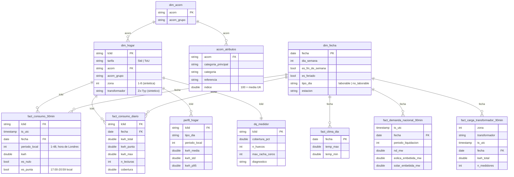

# Fase 2 – Modelo de datos y reglas de limpieza

> Generado con asistencia de IA (Claude). Validar supuestos con el docente.

## Capas

| Capa | Ubicación | Formato | Contenido |
|---|---|---|---|
| bronze | `gs://<proyecto>-lumina-raw/kaggle/` | CSV original | Copia fiel de Kaggle (Fase 1) |
| silver | `gs://<proyecto>-lumina-curated/silver/` | Parquet | Tipado, nombres en español, UTC, banderas de calidad; sin agregar |
| gold | `gs://<proyecto>-lumina-curated/gold/` | Parquet | Modelo estrella, agregados, perfiles y calidad por medidor |
| warehouse | BigQuery `lumina_curated` | tablas nativas | Carga de gold (gratis) + clima NOAA GSOD |

Jobs: [src/batch/silver.py](../src/batch/silver.py) (bronze → silver) y [src/batch/gold.py](../src/batch/gold.py) (silver → gold), en Dataproc Serverless.

## Modelo estrella (gold)

También: `fact_clima_hora` (DarkSky horario), `fact_carga_zona_30min` (agregado por zona) y, en BigQuery, `clima_noaa_heathrow` (GSOD, estación 037720).

## Reglas de limpieza (de perfilar la muestra)

| Hallazgo | Regla |
|---|---|
| `energy(kWh/hh)` llega como texto con espacios (`" 0 "`) y `Null` | `trim` + cast a double; `Null` → `kwh = NULL`, `es_nulo = true` |
| `tstp` con 7 decimales | se parsean los primeros 19 caracteres |
| Lecturas fuera de la grilla de 30 min (ej. `15:13:41`) | `fuera_de_grilla = true` en silver; se excluyen de gold y se cuentan en `dq_medidor` |
| Duplicados `(lclid, ts)` | se conserva uno; el conteo queda en `dq_medidor` |
| Lecturas de medidores en UTC (48 por día incluso en cambio de hora) | `ts_utc = tstp`; hora local de Londres solo para `periodo_local`, `es_punta` y perfiles |
| Demanda nacional en hora local (46/50 periodos en cambio de hora) | `ts_utc = to_utc(fecha 00:00 Europe/London) + (periodo − 1) × 30 min` |
| `Acorn` = `ACORN-` o `ACORN-U` (51 hogares) | `acorn = 'DESCONOCIDO'`, `acorn_grupo = 'Desconocido'` |
| `acorn_details.csv` en ISO-8859-1 (símbolo £) | se lee con `encoding = ISO-8859-1` y se pasa a formato largo |
| Clima DarkSky horario con 13 `pressure` nulos | se conservan nulos |

## Supuestos declarados

- `tstp` marca el **inicio** del intervalo de 30 min.
- La hora de DarkSky (`time`) se asume en UTC.
- **Zonas y transformadores sintéticos**: el dataset no trae geografía. `zona = pmod(xxhash64(lclid), 8) + 1` y 14 transformadores por zona (~50 medidores c/u), con hash determinístico (reproducible).
- **Hora punta**: 17:00–20:59 hora de Londres (equivale a la franja 18–21 h del caso).
- **Tipo de día**: no laborable = sábado, domingo o feriado bancario UK.

## Diagnóstico de medidores (`dq_medidor`)

| Diagnóstico | Condición (en orden de prioridad) |
|---|---|
| `sin_datos` | 0 lecturas válidas |
| `ceros_prolongados` | racha de ceros ≥ 48 intervalos (24 h) |
| `cobertura_baja` | cobertura < 90 % del periodo activo |
| `huecos_frecuentes` | > 10 huecos de telemetría |
| `ok` | resto |
