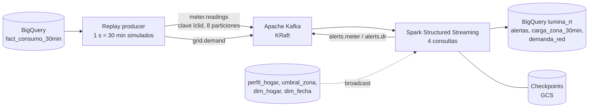

# Fase 3 – Streaming: replay → Kafka → Spark Structured Streaming

> Generado con asistencia de IA (Claude). Validar umbrales y supuestos con el docente.

## Flujo



Todo corre en la VM `lumina-ops` (e2-standard-4) con Docker Compose: Kafka 3.8 en modo KRaft y Spark 3.5 en `local[3]`, más el productor de replay bajo demanda. Código: [src/streaming/](../src/streaming/); operación: [infra/07_vm_ops.sh](../infra/07_vm_ops.sh).

## Consultas de streaming

| Consulta | Lógica | Salida |
|---|---|---|
| `anomalias` | Une cada lectura con el perfil del hogar (misma media hora local y tipo de día). Alerta si `kwh > max(4 × p95, media + 8σ, 1.5 kWh)` o si `kwh < 0` | `alertas` (`consumo_anomalo`, `lectura_negativa`) + tópico `alerts.meter` |
| `carga_zona` | Ventana fija de 30 min por zona con *watermark* de 1 h. Pico si el kW por medidor supera el p95 histórico de la misma zona, estación, tipo de día y media hora, **solo en hora punta (17–21 h)** | `carga_zona_30min`; picos a `alertas` (`pico_zona`) + tópico `alerts.dr` (señal de respuesta a la demanda) |
| `silencio` | Estado por medidor (`applyInPandasWithState`) con *timeout* en tiempo de evento: 2 h (4 intervalos) sin lecturas | `alertas` (`medidor_silencioso`) + `alerts.meter` |
| `demanda` | Paso directo de la demanda nacional | `demanda_red` |

Las escrituras a BigQuery usan la Storage Write API (conector `spark-bigquery`, `writeMethod=direct`). Cada consulta guarda su progreso en `gs://<curated>/checkpoints/streaming/<consulta>`: si el proceso cae, Docker lo reinicia y continúa desde el último offset confirmado.

## Demo: ola de frío del 14 al 20 de enero de 2013

```bash
bash infra/07_vm_ops.sh crear      # o "iniciar" si la VM existe; el stack sube solo (~6 min)
bash infra/07_vm_ops.sh replay --desde 2013-01-14 --dias 7 --segundos-intervalo 1 \
  --concentrador-caido Z3-T07 --caida-desde "2013-01-16 06:00:00" --anomalias 20
bash infra/07_vm_ops.sh destruir   # al terminar: costo 0
```

### Resultados (2026-10-20)

| Prueba | Resultado |
|---|---|
| Lecturas enviadas | 1,836,326 de 5,508 medidores (336 medias horas) en ~6 min, ≈ 5,100 eventos/s (336× tiempo real) |
| Anomalías inyectadas (×10 sobre lecturas > 0.4 kWh) | **20 de 20 detectadas**; 418 alertas en total (0.02 % de las lecturas) |
| Concentrador `Z3-T07` caído el 16-ene a las 06:00 | **Los 52 medidores detectados como silenciosos**, con última lectura a las 05:00–05:30; además, 7 medidores con huecos reales en los datos |
| Demanda nacional | 336 de 336 medias horas |
| Latencia de alertas de anomalía (llegada a Kafka → BigQuery) | p50 21.7 s, p95 46.4 s **con el replay a 336× tiempo real** sobre 3 vCPU; a ritmo real (≈ 3 lecturas/s para 5.5 k medidores) queda acotada por el *trigger* de 5 s |
| Duplicados tras reinicios | 0 (los *checkpoints* evitan reprocesar lotes confirmados) |

### Calibración de umbrales (offline, sin VM)

- **Anomalías.** Con `max(2.5 × p95, media + 4σ, 0.3)` salían ~1,270 alertas por día (10 % de los medidores). Se simularon cinco combinaciones en BigQuery sobre la misma semana y se eligió `max(4 × p95, media + 8σ, 1.5)`: ~57 alertas por día.
- **Picos por zona.** Con el p95 de todo el año, el 61 % de las ventanas de la semana fría salían como pico (la simulación offline dio 63.3 %, lo que valida la lógica del streaming). Con el **p95 de invierno y solo en hora punta**: 0.8 % de las ventanas de un invierno normal y 7.0 % durante la ola de frío, es decir, la señal DR se concentra donde aporta valor. La nueva regla se validará en vivo en el próximo encendido.

## Problemas encontrados y solución

| Problema | Causa | Solución |
|---|---|---|
| BigQuery rechazaba todas las filas (`INVALID_ARGUMENT`) | La Storage Write API solo acepta filas cuya partición esté cerca de la fecha actual, y el replay emite fechas de 2013 | Tablas `lumina_rt` particionadas por `DATE(ts_procesado)`; la fecha del evento queda como columna |
| `NOT_FOUND` al escribir | Tras borrar y recrear una tabla con el mismo nombre, la Write API tarda unos minutos en reconocerla | Esperar; el contenedor se reinicia y retoma desde el *checkpoint* sin perder datos |
| `gcloud compute ssh` pedía confirmar la huella del servidor | En Windows, gcloud usa Plink | Se acepta una vez y queda en caché |

## Costo de la sesión

VM e2-standard-4 encendida 31 min (19:08–19:39 UTC) ≈ US$0.07; luego **destruida** (sin costo de disco). BigQuery: consultas y escrituras dentro del nivel gratuito.
