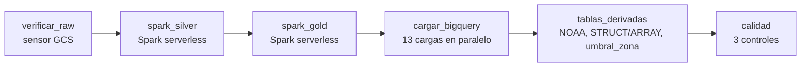

# Orquestación con Apache Airflow

> Generado con asistencia de IA (Claude). Validar con el docente.

## DAG `lumina_batch_diario`



| Grupo | Tareas | Operador | Detalle |
|---|---|---|---|
| Entrada | `verificar_raw` | `GCSObjectsWithPrefixExistenceSensor` | Espera los bloques de medidores en la capa raw (modo *reschedule*: no ocupa un worker mientras espera) |
| Spark | `spark_silver`, `spark_gold` | `DataprocCreateBatchOperator` | Los mismos `silver.py` y `gold.py` de la Fase 2, como cuenta de servicio `lumina-spark`, con máx. 4 ejecutores y TTL de 2 h |
| Carga | `cargar_bigquery.*` (13) | `BigQueryInsertJobOperator` (load) | Parquet → BigQuery con `WRITE_TRUNCATE`; los hechos grandes particionados y clusterizados |
| Derivadas | `tablas_derivadas` | `BigQueryInsertJobOperator` (query) | `src/sql/gold_derivadas.sql`, el mismo SQL que usa `infra/06_cargar_bigquery.sh` |
| Calidad | `sin_duplicados`, `diario_cuadra_con_30min`, `tablas_completas` | `BigQueryValueCheckOperator`, `BigQueryCheckOperator` | Si un control falla, la corrida queda en rojo |

**Parámetro `muestra`**: procesa 2 bloques, escribe en `gs://<curated>/muestra` y carga en el dataset `lumina_muestra`, sin tocar las tablas reales. Cuesta ~US$0.16; la corrida completa, ~US$0.65.

**Idempotencia**: cada tarea sobrescribe su salida (Parquet en modo *overwrite*, BigQuery con `WRITE_TRUNCATE`), así que un reintento o una re-ejecución no duplica datos.

## Programación

- **Taller**: sin programación (`schedule=None`). Al despausar un DAG programado, Airflow lanza por sí solo la corrida del último intervalo; en la primera prueba eso disparó una corrida completa no pedida, que se detuvo antes de llegar a Spark.
- **Producción**: `LUMINA_PROGRAMACION="0 6 * * *"` en el entorno; los jobs pasarían a ser incrementales por partición diaria.

## Cómo correrlo

```bash
bash infra/07_vm_ops.sh crear airflow     # VM con Airflow (~4 min); o "perfiles airflow" si ya está encendida
bash infra/07_vm_ops.sh dag muestra       # dispara la corrida de prueba
bash infra/07_vm_ops.sh tunel             # UI en http://localhost:8080 (usuario admin)
bash infra/07_vm_ops.sh clave_airflow     # contraseña del admin (aleatoria, solo en la VM)
bash infra/07_vm_ops.sh destruir          # al terminar
```

Airflow corre en la VM `lumina-ops` (Docker Compose, perfil `airflow`: LocalExecutor + Postgres). La UI solo escucha en `127.0.0.1` y se accede con túnel SSH. En producción el mismo DAG corre en Managed Service for Apache Airflow (Composer 3).

## Prueba del 2026-10-20 y restricción de cuota

| Paso | Resultado |
|---|---|
| Airflow en la VM (perfil `airflow`) | Arriba en ~4 min; el DAG carga sin errores (22 tareas) |
| `verificar_raw` | Primer intento falló: faltaba la conexión `google_cloud_default`. Se define con `AIRFLOW_CONN_GOOGLE_CLOUD_DEFAULT` (usa las credenciales de la VM, sin secretos) y pasó |
| `spark_silver` | Rechazado al validar: **cuota `CPUS_ALL_REGIONS` = 12 vCPU** (cuenta de prueba). Un batch serverless pide como mínimo 12 vCPU (driver 4 + 2 ejecutores × 4) y la VM ocupa 4 |
| Corrida programada no pedida | Al despausar, Airflow lanzó la corrida del último intervalo (completa); se marcó como fallida antes de llegar a Spark. Corregido con `schedule=None` en el taller |

**Consecuencia:** con la cuota actual no pueden convivir la VM (Airflow o streaming) y un batch de Spark serverless. Costo de la prueba: VM 11 min ≈ US$0.03; el batch rechazado no consumió recursos.
