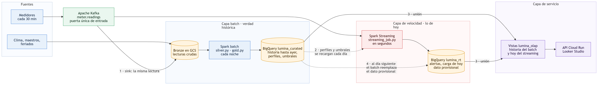
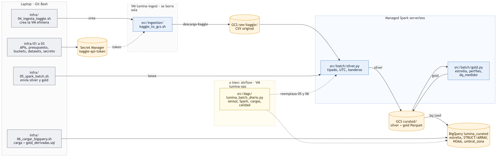
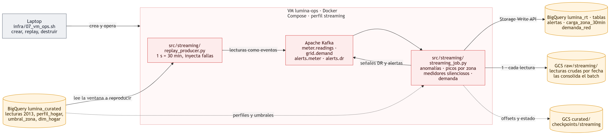

# Arquitectura técnica · qué script corre dónde y para qué

> Generado con asistencia de IA (Claude). Mantener sincronizado al agregar o mover scripts.

La arquitectura se documenta en tres niveles:

| Nivel | Para qué sirve | Diagrama |
|---|---|---|
| Servicios (taller) | Qué servicios de GCP usa el prototipo | [diagrama_arquitectura.png](diagrama_arquitectura.png) |
| Servicios (producción, 4 capas) | Blueprint de la Entrega 1: Ingesta, Cómputo, Almacenamiento, Exposición | [entrega1/diagrama_capas.png](entrega1/diagrama_capas.png) |
| **Técnica** | Qué archivo del repositorio corre en qué máquina o servicio | Los dos diagramas de abajo |

Hay **dos caminos independientes**:

- **Batch** (histórico, una vez al día): Kaggle → GCS → Spark → BigQuery. Lo orquesta **Airflow**, o lo corren a mano los scripts `infra/05` y `infra/06`.
- **Tiempo real** (cada lectura, en segundos): medidores → **Kafka** → **Spark Structured Streaming** → alertas. Airflow **no** participa; en el taller los medidores se simulan con un *replay* de los datos de 2013.

## Batch y streaming: arquitectura Lambda

Hay dos enfoques clásicos para combinar batch y streaming:

| | **Lambda** (el que usamos) | **Kappa** |
|---|---|---|
| Idea | Capa batch (verdad histórica) + capa de velocidad (lo reciente) + capa de servicio que las une | Un solo camino de streaming; la historia se reprocesa releyendo el log de Kafka |
| A favor | El batch recalcula todo con exactitud; el streaming da latencia de segundos | Un solo código, nada que sincronizar |
| En contra | Dos lógicas que mantener y sincronizar | Reprocesar 2 años desde el log es caro; entrenar perfiles y modelos sobre streaming es incómodo |

**Por qué Lambda en Lumina:** los perfiles por hogar, el pronóstico D+1 y los informes necesitan recalcular toda la historia, y eso es trabajo de batch. Para que las dos lógicas no se separen, ambas capas usan **el mismo motor (Spark)** y **una sola puerta de entrada (Kafka)**.

**Sentido de los flujos:** los **datos** van del streaming al batch (cada lectura en vivo se copia a bronze y el batch la vuelve definitiva); del batch al streaming solo viajan **reglas** (perfiles y umbrales). El batch no escribe en `lumina_rt`: la precedencia del batch es una regla de las vistas.

### Puntos de sincronización

| # | Qué se sincroniza | Cómo | Dónde | Estado |
|---|---|---|---|---|
| 1 | Lectura en vivo → historia | `streaming_job.py` guarda cada lectura en `raw/streaming/` (bronze) además de evaluarla; el batch de la noche la consolida en `curated` | Consulta `bronze` en `streaming_job.py` (file sink Parquet por fecha, exactly-once); `silver.py --entrada-streaming` lo consolida | 🟡 Implementado; falta probarlo en vivo |
| 2 | Lo aprendido → streaming | `perfil_hogar` y `umbral_zona` (batch) son los umbrales del streaming | `streaming_job.py`: `Contexto.refrescar()` en cada micro-lote, cada `--refresco-horas` (24) | 🟡 Implementado; falta probarlo en vivo |
| 3 | Historia + hoy → consumo | Vistas que unen `lumina_curated` (hasta ayer) con `lumina_rt` (hoy) | `src/sql/olap_vistas.sql`: `v_carga_zona_30min` y demás vistas de `lumina_olap` | ✅ Vistas creadas |
| 4 | Dato provisional → definitivo | Las vistas toman de `lumina_rt` solo lo posterior a lo último que procesó el batch; **si hay diferencia, manda el batch** (incorpora lecturas atrasadas y correcciones) | `v_carga_zona_30min`: de `rt` solo `ts_utc` > último `ts_utc` del batch, última versión por `ts_procesado` | ✅ Regla en la vista (0 filas de `rt` con el replay de 2013, como corresponde) |

## Camino batch

## Camino tiempo real

## Referencia de scripts

| Archivo | Dónde corre | Cuándo | Qué hace | Lee | Escribe |
|---|---|---|---|---|---|
| `infra/01_apis_presupuesto.sh` | Laptop | Una vez | Habilita APIs; crea el presupuesto con alertas | — | Billing Budget |
| `infra/02_buckets_bigquery.sh` | Laptop | Una vez | Crea buckets y datasets; Private Google Access | — | GCS, BigQuery |
| `infra/03_secreto_kaggle.sh` | Laptop (lo corre el alumno) | Una vez | Sube el token de Kaggle | `infra/config.env` | Secret Manager |
| `infra/04_ingesta_kaggle.sh` | Laptop | Una vez | Crea la VM efímera, espera y la borra | — | VM `lumina-ingest` |
| `src/ingestion/kaggle_to_gcs.sh` | VM `lumina-ingest` (startup script) | Una vez | Descarga los datasets de Kaggle | Kaggle, Secret Manager | `raw/kaggle/` |
| `infra/05_spark_batch.sh` | Laptop | Manual | Sube el código y envía `silver` o `gold`; registra el costo | `src/batch/` | Spark serverless, `bitacora_costos.log` |
| `src/batch/silver.py` | Managed Spark serverless | Por corrida batch | Tipado, UTC, banderas de calidad; consolida Kaggle y lo que guardó el streaming | `raw/kaggle/`, `raw/streaming/` | `curated/silver/` |
| `src/batch/gold.py` | Managed Spark serverless | Por corrida batch | Modelo estrella, agregados, perfiles, `dq_medidor` | `curated/silver/` | `curated/gold/` |
| `src/batch/lumina_common.py` | Spark serverless (dependencia) | — | Sesión Spark, argumentos, escritura de Parquet | — | — |
| `infra/06_cargar_bigquery.sh` | Laptop | Manual | Carga gold en BigQuery y crea las tablas derivadas | `curated/gold/`, `src/sql/gold_derivadas.sql` | `lumina_curated` |
| `src/sql/gold_derivadas.sql` | BigQuery | Tras cada carga | NOAA GSOD, `consumo_dia_anidado` (STRUCT/ARRAY), `umbral_zona` | `lumina_curated`, NOAA público | `lumina_curated` |
| `src/dags/lumina_batch_diario.py` | VM `lumina-ops`, contenedor Airflow (perfil `airflow`) | Manual en el taller; diario en producción | Orquesta: sensor → silver → gold → 13 cargas → derivadas → 3 controles de calidad | GCS | Spark serverless, BigQuery |
| `infra/07_vm_ops.sh` | Laptop | Por demo | Crea, opera y destruye la VM `lumina-ops`; dispara el replay y el DAG | — | VM, metadata |
| `infra/ops/vm_startup.sh` | VM `lumina-ops` (cada arranque) | Al encender | Instala Docker, baja el código y levanta los perfiles | `curated/_ops/bundle.tgz` | Contenedores |
| `infra/ops/docker-compose.yml` | VM `lumina-ops` | Al encender | Define Kafka, Spark Streaming, replay, Airflow y Postgres | — | — |
| `src/streaming/replay_producer.py` | VM `lumina-ops`, contenedor `replay` | Por demo | Reproduce lecturas de 2013 como eventos; inyecta fallas | `lumina_curated` | Kafka `meter.readings`, `grid.demand` |
| `src/streaming/streaming_job.py` | VM `lumina-ops`, contenedor `spark-streaming` (perfil `streaming`) | Continuo mientras la VM está encendida | Anomalías, picos por zona, medidores silenciosos, demanda; copia cruda a bronze; recarga reglas cada 24 h | Kafka, `lumina_curated` | `lumina_rt`, `raw/streaming/`, Kafka `alerts.*`, checkpoints en GCS |
| `src/sql/streaming_tablas.sql` | BigQuery | Una vez | Crea las tablas de salida del streaming | — | `lumina_rt` |
| `infra/08_tarifas_dtou.sh` | Laptop | Una vez | Descarga el calendario oficial dToU 2013 y lo carga | UK Power Networks (`Tariffs.xlsx`) | `raw/tarifas/`, `lumina_curated.dim_tarifa_dtou` |
| `src/ingestion/tarifas_dtou.py` | Laptop | Una vez | Convierte el Excel a CSV por media hora en UTC, con el precio de cada nivel | `Tariffs.xlsx` | CSV |
| `infra/09_vistas_olap.sh` + `src/sql/olap_vistas.sql` | BigQuery | Una vez (las vistas se recalculan al consultarlas) | Capa de servicio Lambda: une `curated` y `rt` (sincronización 3 y 4) | `lumina_curated`, `lumina_rt` | `lumina_olap` (5 vistas) |
| `infra/11_tarifas.sh` + `src/sql/tarifas.sql` | BigQuery | Al cambiar tarifas | Factura 2013 con tarifa dinámica y plana; respuesta a eventos de precio | `fact_consumo_30min`, `dim_tarifa_dtou`, `dim_hogar` | `lumina_ml.factura_tarifas_2013`, `respuesta_eventos_2013` |
| `infra/10_pronostico.sh` + `src/sql/pronostico.sql` | BigQuery ML | Al reentrenar (en producción, semanal) | Variables, dos modelos boosted tree D+1 (zona y hogar), pronósticos y métricas; imprime el costo real | `lumina_curated` | `lumina_ml` (`modelo_*_d1`, `pronostico_*_d1`, `metricas_pronostico`) |
| `src/api/main.py` (+ `Dockerfile`) | Cloud Run (pendiente de desplegar) | Por petición, escala a cero | API REST de solo lectura con tope de bytes por consulta | `lumina_olap`, `lumina_ml`, `lumina_curated` | — |
| `src/costos/calculadora_consumo.py` | Laptop | Al cambiar supuestos | Costo del primer año en producción | Supuestos del script | `docs/entrega1/calculadora_consumo.md` |
| `infra/shutdown.sh` / `infra/teardown.sh` | Laptop | Fin de sesión / fin de curso | Apaga lo que cobra por hora / borra todo | — | — |
