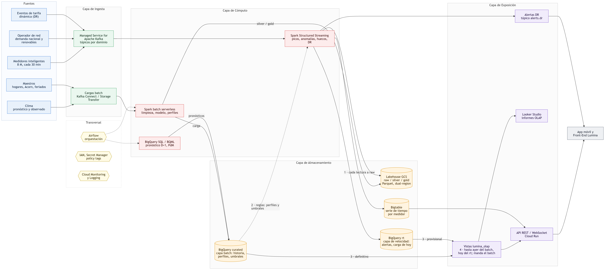

> Documento elaborado con asistencia de IA generativa (Claude). Las cifras de costo usan precios de lista de Google Cloud (us-central1, octubre de 2026) y deben validarse con la Google Cloud Pricing Calculator; las decisiones técnicas, con el docente.

# Resumen ejecutivo

Lumina Energía necesita convertir las lecturas de 8 millones de medidores inteligentes, hoy usadas solo para facturar, en decisiones de red en tiempo real, planes diarios de demanda, informes operativos y mantenimiento predictivo. Proponemos un **lakehouse en Google Cloud con APIs de código abierto** (Kafka, Spark, Airflow, Parquet) sobre servicios gestionados, con BigQuery como data warehouse y Bigtable para servir la app.

| Indicador | Valor | Fuente |
|---|---|---|
| Lecturas por día (8 M medidores, cada 30 min) | 384 M | Dimensionamiento |
| Costo de plataforma, primer año, producción | ≈ US$29 k (US$0.0003 por medidor al mes) | Calculadora (§ 6) |
| Escenario de lectura cada 1 min | ≈ US$157 k/año, el costo por lectura baja 5.6× | Calculadora (§ 6) |
| Carga en hora punta (17–21 h) sobre el promedio diario | +39 % | Datos del caso, BigQuery |
| Consumo por hogar en los días más fríos | +33 % | Datos del caso, BigQuery |
| Prototipo implementado: lecturas procesadas y validadas | 167.8 M, coincidencia exacta con la fuente | Fase 2 |
| Costo del prototipo hasta hoy | ≈ US$1 de US$300 | Bitácora de costos |

# Arquitectura end-to-end

{width=100%}

| Capa | Componentes | Función |
|---|---|---|
| **Ingesta** | Managed Service for Apache Kafka; Kafka Connect y Storage Transfer para cargas batch | Recibir lecturas, demanda de red y eventos de tarifa como flujo; traer clima y maestros por lotes |
| **Cómputo** | Spark Structured Streaming (24/7); Spark batch serverless (Managed Service for Apache Spark, ex Dataproc Serverless); BigQuery SQL/BQML | Detectar picos, anomalías y huecos en segundos; limpiar y modelar el histórico; pronosticar la demanda D+1 |
| **Almacenamiento** | Lakehouse en GCS (raw, silver, gold en Parquet); BigQuery `curated` (capa batch) y `rt` (capa de velocidad); Bigtable | Fuente de verdad barata y abierta; warehouse analítico histórico y de lo reciente; serie de tiempo por medidor para la app |
| **Exposición** | Vistas `lumina_olap` (unen historia y hoy); API REST/WebSocket en Cloud Run; Looker Studio; tópico `alerts.dr` | Una sola vista de los datos para la app, los informes OLAP y las señales de respuesta a la demanda |
| Transversal | Airflow (Composer 3), IAM, Secret Manager, policy tags, Cloud Monitoring y Logging | Orquestación, seguridad, gobierno y observabilidad |

## Patrón Lambda: cómo se combinan batch y streaming

La arquitectura sigue el patrón **Lambda**: una **capa batch** que guarda la verdad histórica y aprende qué es normal para cada hogar, una **capa de velocidad** que evalúa cada lectura nueva en segundos, y una **capa de servicio** que las une. Se descartó **Kappa** (solo streaming, reprocesando la historia desde el log de Kafka), porque los perfiles por hogar, el pronóstico D+1 y los informes requieren recalcular dos años de historia, y eso es más barato y simple en batch. Para no duplicar lógica, ambas capas usan el mismo motor (Spark) y una sola puerta de entrada (Kafka).

{width=100%}

**Sentido de los flujos:** los **datos** van del streaming al batch (cada lectura en vivo se copia a bronze y el batch la vuelve definitiva); del batch al streaming solo viajan **reglas** (perfiles y umbrales). El batch no escribe en `lumina_rt`: la precedencia del batch es una regla de las vistas.

| # | Sincronización | Mecanismo |
|---|---|---|
| 1 | La lectura en vivo pasa a la historia | El job de streaming guarda cada lectura en bronze (además de evaluarla); el batch nocturno la consolida en `curated` |
| 2 | Lo aprendido llega al streaming | `perfil_hogar` y `umbral_zona` (batch) son los umbrales del streaming; se recargan cada día |
| 3 | Una sola vista para el consumo | Las vistas `lumina_olap` unen `curated` (hasta ayer) con `rt` (hoy) |
| 4 | El dato provisional se vuelve definitivo | De `rt` solo se toma lo posterior al último batch; si hay diferencia, manda el batch, que incorpora lecturas atrasadas |

## Producción frente al prototipo del taller

El prototipo usa los mismos motores y formatos con menos capacidad, para mantenerse dentro de US$300:

| Pieza | Producción | Prototipo (implementado o planificado) |
|---|---|---|
| Bus de eventos | Managed Service for Apache Kafka, 3 zonas | Kafka (KRaft) en una VM que se enciende por sesión |
| Streaming | Clúster Spark 24/7 | Spark Structured Streaming en la misma VM |
| Batch | Spark serverless diario | Spark serverless, **implementado** (silver y gold) |
| Orquestación | Composer 3 | Airflow en la VM (mismos DAGs) |
| Serving de la app | Bigtable + Cloud Run | BigQuery + Cloud Run |
| Lake | GCS dual-region | GCS regional, **implementado** |

# Integración multifuente

## Fuentes y mecanismo de captura

| Fuente | Tipo | Velocidad | Captura | Llave de cruce |
|---|---|---|---|---|
| Lecturas de medidores (`halfhourly_dataset`) | IoT | 30 min (→ 1 min) | Streaming (Kafka) | `lclid`, `ts_utc` |
| Hogares y segmento Acorn | Maestro | Casi estática | Batch | `lclid` → `acorn` |
| Perfil demográfico Acorn | Referencia | Estática | Batch | `acorn` |
| Clima DarkSky (horario, diario) | Externa | Horaria | Batch (prod.: API de pronóstico) | `ts_utc` / `fecha` |
| Clima NOAA GSOD (Heathrow) | Warehouse público | Diaria | Consulta directa en BigQuery | `fecha` |
| Feriados del Reino Unido | Calendario | Anual | Batch | `fecha` |
| Demanda nacional y renovables (National Grid ESO) | Externa, red | 30 min | Streaming / batch | `ts_utc` |
| Eventos de tarifa dinámica (dToU 2013) | Externa, precio | Eventos | Streaming | `ts_utc` |

## Cómo se cruzan los datos

- **Tiempo común en UTC.** Las lecturas ya vienen en UTC (48 por día incluso en cambio de hora). La demanda nacional viene en *settlement periods* de hora local de Londres (46 o 50 en cambio de hora); se convierte con `ts_utc = medianoche local en UTC + (periodo − 1) × 30 min`. La hora punta y los perfiles se calculan en hora local.
- **Modelo estrella** con `dim_hogar` (tarifa, Acorn, zona y transformador), `dim_fecha` (feriado, tipo de día, estación) y `dim_acorn`, más hechos de consumo a 30 min y diario, carga por transformador y zona, demanda nacional y clima. Detalle en `docs/02_modelo_datos.md`.
- **Geografía sintética declarada.** El dataset no trae ubicación, así que se asignan 8 zonas de concesión y 112 transformadores con un hash determinístico del medidor.
- **Calidad desde el origen.** Lecturas `Null`, fuera de la grilla de 30 min y duplicadas se marcan en silver; `dq_medidor` diagnostica a cada medidor.

## Evidencia del prototipo

- 167,811,461 lecturas en gold; 3,510,403 medidor-día coinciden **exactamente** con el agregado diario publicado en Kaggle (35.54 GWh en ambos lados).
- Diagnóstico de 5,561 medidores: 5,068 sin problemas, 240 con huecos frecuentes, 232 con más de 24 h seguidas en cero y 21 con cobertura menor al 90 %.

# Definición de ingesta y almacenamiento

## Ingesta

| Flujo | Mecanismo | Por qué |
|---|---|---|
| Lecturas, demanda de red, eventos de tarifa | Kafka, tópicos `meter.readings`, `grid.demand`, `tariff.events`; clave = medidor o zona | Orden por medidor, reproceso (*replay*) y retención de 7 días; API abierta |
| Lake raw | Kafka Connect, sink a GCS cada pocos minutos | Copia inmutable para reprocesar sin depender del streaming |
| Clima, maestros, calendario | Cargas batch programadas por Airflow | Cambian poco; no justifican streaming |
| Clima público | Consulta federada a `bigquery-public-data.noaa_gsod` | Cero ingesta: el dato ya está en el warehouse |

## Almacenamiento según volumen y velocidad

| Motor | Qué guarda | Por qué este |
|---|---|---|
| **Lakehouse GCS (Parquet)** | Todo el histórico en raw, silver y gold | US$0.02/GB-mes; formato abierto. En el prototipo, 7.3 GB de CSV quedan en 0.9 GB de Parquet (5.6 bytes por lectura) |
| **BigQuery** | Modelo estrella; `fact_consumo_30min` particionada por día y clusterizada por medidor; tabla anidada con `STRUCT`/`ARRAY` | SQL serverless para OLAP y ML; la tabla anidada lee 48× menos bytes en análisis por segmento |
| **Bigtable** | Últimos 7 días por medidor, clave `medidor#ts` invertido | Lecturas de milisegundos para 9 M usuarios de la app; BigQuery no está hecho para consultas puntuales masivas |
| **Kafka** | Log de eventos de 7 días | Buffer ante picos y caídas; permite reprocesar |

# Justificación del stack tecnológico

Criterios: (1) APIs de código abierto exigidas por la RFP de Lumina, para evitar dependencia del proveedor; (2) servicios gestionados de GCP vistos en clase cuando quitan operación sin costo excesivo; (3) pago por uso para el batch, que es esporádico.

| Decisión | Elegido | Alternativas evaluadas | Razón |
|---|---|---|---|
| Bus de eventos | Managed Service for Apache Kafka | Pub/Sub | Pub/Sub es más simple, pero propietario; Kafka da orden por partición, *replay* y la API abierta que pide la RFP, ahora sin operar brokers |
| Procesamiento | Apache Spark (streaming y batch) | Dataflow (Apache Beam) | Un solo motor y lenguaje para ambos caminos; Spark corre en cualquier nube; Dataflow ata el runner a Google |
| Batch | Spark serverless | Clúster Dataproc permanente | Se paga solo mientras corre: el histórico completo costó US$0.65 |
| Warehouse | BigQuery | Bigtable, Spanner, Cloud SQL | Columnar y serverless, con particiones, clustering, `STRUCT` y BQML; 1 TB de consultas gratis al mes |
| Serving por medidor | Bigtable | Memorystore, Cloud SQL | Escala lineal por nodo y latencia de milisegundos para series de tiempo |
| Orquestación | Apache Airflow (Composer 3 en producción, VM en el taller) | Cloud Workflows, Cloud Scheduler | Estándar abierto; los mismos DAGs se mueven entre VM y Composer |
| Formato | Parquet (Iceberg como evolución) | CSV, Avro | Columnar y comprimido; lo leen Spark, BigQuery y pandas |
| Exposición | Cloud Run + Looker Studio | GKE, App Engine, Looker | Escala a cero y sube con la demanda; Looker Studio es gratuito |

# Escalabilidad y performance

## Modelo de carga

| Métrica | Base (30 min) | Crecimiento (1 min) |
|---|---|---|
| Medidores | 8.0 M (89 % de 9 M clientes) | 8.0 M |
| Lecturas por día | 384 M | 11,534 M |
| Eventos por segundo, promedio | 4.4 k | 133 k |
| Ráfaga si todos los medidores envían en el mismo minuto | 133 k/s (≈ 13 MB/s) | 1.3 M/s (≈ 134 MB/s) |
| Volumen anual en el lake (raw + silver + gold) | 3.7 TB | 110 TB |

## El "Black Friday" de una red eléctrica

En retail el pico es de transacciones. En una red, el **número de lecturas no sube** (depende de cuántos medidores hay y cada cuánto leen). Lo que sube en una ola de frío es:

1. **La carga eléctrica.** En los datos del caso la hora punta supera al promedio diario en 39 % (el máximo de media hora, en 54 %), y en el 5 % de días más fríos cada hogar consume 33 % más. Esto multiplica las **alertas** y los **eventos de respuesta a la demanda** que el streaming debe emitir.
2. **Las consultas de la app.** Los clientes revisan su consumo y su costo; se asume hasta 3× el tráfico normal.
3. **Las ráfagas de reconexión.** Tras un corte, los concentradores reenvían de golpe las horas acumuladas.

## Cómo escala cada capa

| Capa | Mecanismo | Frente al pico |
|---|---|---|
| Ingesta | Particiones de Kafka por medidor; más vCPU por cada ~15 MB/s | Kafka absorbe ráfagas y reenvíos; los consumidores se ponen al día sin perder datos |
| Cómputo streaming | Ejecutores de Spark con asignación dinámica; *watermark* para datos tardíos | Un nodo de 4 vCPU adicional por cada ~20 MB/s de ráfaga |
| Cómputo batch | Spark serverless escala ejecutores por job | Medido en el prototipo: ~264 k lecturas/s con 20 DCU; un día de producción (384 M) toma ~25 min con 20 DCU o ~5 min con 100 DCU |
| Almacenamiento | BigQuery particionado y clusterizado; Bigtable agrega nodos en línea | Las consultas leen solo la partición y el medidor pedidos |
| Exposición | Cloud Run autoescala por concurrencia; Looker Studio sobre tablas agregadas | 3× de tráfico se cubre con más instancias, sin tocar el warehouse |

**Escalar a otras regiones metropolitanas:** cada metrópoli es un prefijo de tópicos, un conjunto de particiones y un valor de `region` en las tablas (particiones o datasets separados); el código no cambia.

# Justificación económica y optimización de costos

## Calculadora de consumo del primer año (producción)

Supuestos: 8 M medidores, retención de 7 días en Kafka, 10 TiB/mes de consultas OLAP, 30 M requests/mes a la API. El almacenamiento crece linealmente durante el año. El script `src/costos/calculadora_consumo.py` regenera estas tablas al cambiar un supuesto.



## Lectura de las cifras

- **El costo por lectura baja al crecer.** Pasar a 1 min multiplica las lecturas por 30 pero el costo por 5.4, porque los componentes fijos (Composer, API, consultas) se reparten entre más datos.
- **El costo de plataforma es despreciable frente a la energía.** US$0.001 por MWh distribuido equivale a alrededor de 0.001 % de un precio mayorista típico de US$80/MWh.
- **El mayor rubro es Bigtable**, por servir 9 M de usuarios con latencia de milisegundos; si la app tolera segundos, puede sustituirse por BigQuery con BI Engine y el total baja ~40 %.

## Palancas de optimización aplicadas

| Palanca | Ahorro |
|---|---|
| Batch serverless en vez de clúster permanente | Se paga solo durante el job (prototipo: US$0.65 por todo el histórico) |
| Parquet en vez de CSV | 6× menos almacenamiento y lectura |
| Partición por día + clustering por medidor | Las consultas por medidor y rango leen solo lo necesario |
| Tabla anidada con `STRUCT`/`ARRAY` para análisis por medidor-día | 48× menos bytes en la consulta por segmento Acorn (4.3 GB → 91 MB) |
| A 1 min, detalle en BigQuery solo 90 días; histórico en el lake | Evita ~200 TB en el warehouse |
| Ciclo de vida GCS (Nearline/Coldline para raw antiguo) y descuentos por uso comprometido en Kafka y Bigtable | 20–50 % en esos rubros (no incluido en la calculadora) |

## Valor para el negocio

- **Reducción del pico (ilustrativo).** Con un consumo medio de 0.43 kW por hogar y la punta 39 % sobre el promedio, la punta agregada es ≈ 4.8 GW. Recortar 5 % evita ≈ 240 MW de compras de emergencia. Con una prima supuesta de US$100/MWh durante 4 h en 90 días de invierno, son ≈ US$8.6 M al año, unas 290 veces el costo de la plataforma.
- **Tarifa dinámica frente a fija.** El ensayo Low Carbon London (2013) usó tres precios dToU (alto, normal y bajo) contra una tarifa plana. La Fase 4 calculará la factura de cada hogar ToU con el calendario de eventos de 2013 y la comparará con lo que habría pagado en tarifa fija. Dato preliminar, sin control por segmento: los hogares ToU consumen 9.50 kWh/día frente a 10.28 de los de tarifa estándar (−7.6 %).
- **Costo operativo por kWh.** Se reportará en Looker Studio como (costo de plataforma + compras de emergencia evitadas) / kWh distribuido, por zona y mes.

# Plan de recuperación y alta disponibilidad (DRP/HA)

## Objetivos por nivel de servicio

| Servicio | RPO (datos que se pueden perder) | RTO (tiempo para volver) |
|---|---|---|
| Ingesta de lecturas | 0: el medidor guarda sus lecturas y el concentrador las reenvía | < 1 min ante fallo de zona |
| Alertas y respuesta a la demanda | 0 (se reprocesa desde Kafka) | < 10 min |
| App de clientes (consumo en vivo) | ≤ 1 min | < 1 min (zona), < 1 h (región) |
| Informes OLAP y pronóstico D+1 | ≤ 24 h | < 4 h |

## Componentes, fallas y mitigación

| Componente | Falla | Mitigación |
|---|---|---|
| Medidor o concentrador | Deja de enviar | Spark detecta el silencio por *watermark* y estado y emite `meter.silent`; al reconectar, las lecturas atrasadas se aceptan hasta 72 h y la conciliación nocturna recalcula los agregados; `dq_medidor` marca huecos y rachas de ceros. Nunca se imputa consumo facturable |
| Kafka | Caída de un broker o una zona | 3 zonas, factor de réplica 3, `min.insync.replicas = 2`, `acks = all`; la conmutación es automática |
| Spark Streaming | Caída del job o del nodo | *Checkpoints* en GCS dual-region; reinicio automático desde el último offset; escritura idempotente a BigQuery (Storage Write API con *offsets* o `MERGE`) |
| Lake GCS | Pérdida regional o borrado | Bucket dual-region (nam4) con replicación turbo (RPO 15 min); versionado y *soft delete* de 7 días en curated |
| BigQuery | Error humano o corrupción | *Time travel* y *fail-safe* de 7 días cada uno; snapshots diarios de gold; réplica de datasets en otra región; reconstrucción total desde el lake (medido: 32 min con 20 DCU) |
| Bigtable | Caída de zona o región | Dos clústeres replicados con enrutamiento multi-clúster; conmutación en segundos |
| Cloud Run | Caída de zona | Servicio regional multizona; en producción, balanceador global con una segunda región |
| Airflow | Caída del entorno | DAGs en Git; entorno recreado por infraestructura como código; tareas idempotentes con *catchup* |

## Runbook resumido ante caída regional

1. Activar la región secundaria: Bigtable conmuta solo; Cloud Run detrás del balanceador global.
2. Los concentradores acumulan; Kafka secundario (MirrorMaker 2) recibe el tráfico.
3. Spark Streaming arranca en la región secundaria desde los *checkpoints* dual-region.
4. Reprocesar con Spark batch el intervalo afectado desde el lake; validar conteos contra la fuente, como en el prototipo.
5. Postmortem y prueba de recuperación trimestral (en el taller: matar el job de streaming y verificar que retoma desde el *checkpoint*).

# Seguridad y gobernanza

- **Privacidad.** El consumo revela hábitos del hogar: el identificador del medidor va seudonimizado; las vistas OLAP solo publican agregados de al menos 10 hogares; las columnas sensibles llevan *policy tags* de BigQuery.
- **Mínimo privilegio.** Una cuenta de servicio por función (en el prototipo, `lumina-ingest` y `lumina-spark`); credenciales en Secret Manager y nunca en el repositorio.
- **Calidad y linaje.** Capas raw, silver y gold separadas; reglas de calidad versionadas; auditoría con Cloud Audit Logs.

# Supuestos y fuera de alcance

**Supuestos:** 89 % de 9 M clientes con medidor; zonas y transformadores sintéticos; `tstp` marca el inicio del intervalo; hora DarkSky en UTC; clima observado como sustituto del pronóstico; precios de lista sin descuentos.

**Fuera de alcance:** facturación real, integración con los sistemas de las 12 distribuidoras, control físico de termostatos y baterías, y el front-end (adjudicado en otra RFP).

# Próximos pasos

| Entrega | Fecha | Alcance |
|---|---|---|
| 2 | 7 de noviembre de 2026 | Streaming: replay → Kafka → Spark Structured Streaming (picos, anomalías, medidores en silencio); DAGs de Airflow |
| 3 | 20–21 de noviembre de 2026 | Pronóstico D+1, vistas OLAP, API en Cloud Run, demo end-to-end, slides con KPIs y calculadora |

# Referencias

- Datasets: Smart Meters in London (Kaggle, jeanmidev); Electricity consumption UK 2009–2024 (Kaggle, albertovidalrod); NOAA GSOD (BigQuery público).
- Precios: [Managed Service for Apache Spark](https://cloud.google.com/dataproc-serverless/pricing), [Managed Service for Apache Kafka](https://cloud.google.com/managed-service-for-apache-kafka/pricing), [Bigtable](https://cloud.google.com/bigtable/pricing), [Managed Service for Apache Airflow](https://cloud.google.com/composer/pricing), [BigQuery](https://cloud.google.com/bigquery/pricing).
- Código, modelo de datos y bitácora de costos: repositorio `dataenergia-lumina` (`docs/02_modelo_datos.md`, `docs/bitacora_costos.log`).
