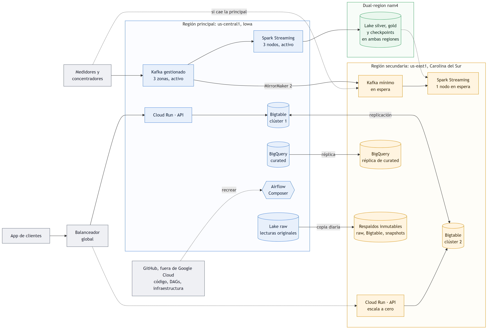

> Documento elaborado con asistencia de IA generativa (Claude). Las cifras de costo usan precios de lista de Google Cloud (región us-central1, octubre de 2026) y deben validarse con la Google Cloud Pricing Calculator; las decisiones técnicas, con el docente.
>
> Cada término técnico y cada sigla se explican la primera vez que aparecen. El Glosario (§ 13) los reúne todos.

# Resumen ejecutivo

Este documento presenta al comité ejecutivo, de negocio y técnico, la arquitectura de datos propuesta para Lumina Energía: qué problema resuelve, cuánto cuesta, qué beneficio trae, qué riesgos tiene y cómo se implementaría. Las secciones 2 a 9 dan el detalle técnico que sostiene cada cifra.

## El problema

- **La hora punta es cara.** Entre las 17 y las 21 h, la demanda supera al promedio del día en 39 %, y en los días más fríos cada hogar consume 33 % más. Los transformadores se sobrecargan y la red compra energía de emergencia a precios altos.
- **Los datos existen, pero no se usan.** Casi nueve de cada diez de los 9 M de clientes tienen un medidor inteligente que reporta cada 30 minutos. Esas lecturas solo sirven para facturar a fin de mes.
- **Las doce distribuidoras no comparten datos.** Nadie ve la red completa, así que no se puede balancear la carga entre zonas ni detectar fallas y pérdidas a escala regional.

## La propuesta

Una plataforma de datos única en Google Cloud que recibe las lecturas de 8 millones de medidores y las convierte en cuatro capacidades:

- **decisiones de red en tiempo real:** picos, anomalías y medidores caídos detectados en segundos;
- **planes diarios de demanda:** el pronóstico de mañana por zona;
- **informes operativos:** consumo por segmento y efecto de la tarifa dinámica;
- **mantenimiento predictivo:** anticipar fallas de medidores y equipos antes de que ocurran.

Técnicamente es un **lakehouse**, que combina dos tipos de almacén:

- un *data lake*, un almacén de archivos barato que guarda todos los datos, crudos y limpios;
- un *data warehouse*, una base de datos analítica para consultas rápidas en SQL. Aquí es BigQuery.

Las piezas usan **APIs de código abierto**: Kafka, Spark, Airflow y el formato Parquet, descritos más abajo en la arquitectura. Una API (interfaz de programación) es la forma en que un programa se comunica con otro; si es abierta, el mismo código funciona con otro proveedor. Las piezas corren como **servicios gestionados**: Google opera los servidores y Lumina solo los usa.

La propuesta no es solo un diseño. Un prototipo en Google Cloud ya procesó los 167.8 M de lecturas reales del caso, con coincidencia exacta con la fuente, por ≈ US$1.7.

## Lo que se pide al comité

1. **Aprobar la arquitectura** como plataforma de datos común de las doce distribuidoras.
2. **Aprobar el costo de operación del primer año: ≈ US$36 k.** Son ≈ US$29 k de plataforma (§ 7) más ≈ US$7 k para operar desde una segunda región si la principal cae (§ 8).
3. **Aprobar un piloto de 4 meses en 2 zonas** antes del despliegue total (§ 11), con criterios de éxito medibles.
4. **Encargar los acuerdos de intercambio de datos** con las distribuidoras, que son la condición para empezar.

## Inversión y beneficio

| Concepto | Valor anual | Base |
|---|---|---|
| Costo de la plataforma | ≈ US$29 k | Calculadora con precios de lista (§ 7) |
| Costo de la recuperación ante desastres | ≈ US$7 k adicionales | Segunda región en espera (§ 8) |
| **Costo total** | **≈ US$36 k** | US$0.0004 por medidor al mes |
| Compras de emergencia evitadas | ≈ US$9.6 M | Recorte medido de 5.6 % en la punta y una prima supuesta de US$100/MWh (§ 7) |
| Ahorro para los clientes con tarifa dinámica | −2.74 % en su factura | Calendario oficial de precios 2013 y consumo real |

El beneficio estimado es unas **270 veces el costo total**. Aunque el recorte en DataLandia fuera la décima parte del medido en Londres, la plataforma se pagaría unas 27 veces. Esta cifra es la más sensible del documento: depende de la prima de emergencia supuesta y de que los clientes respondan como en el experimento de 2013. Por eso el piloto la mide antes del despliegue total.

## Indicadores

| Indicador | Valor | Fuente |
|---|---|---|
| Lecturas por día (8 M medidores, una cada 30 min) | 384 M | Dimensionamiento |
| Costo de la plataforma en producción, primer año | ≈ US$29 k (US$0.0003 por medidor al mes) | Calculadora (§ 7) |
| Escenario con una lectura por minuto | ≈ US$157 k/año; el costo por lectura baja 5.6× | Calculadora (§ 7) |
| Carga en **hora punta** (17–21 h, cuando más energía se consume) sobre el promedio diario | +39 % | Datos del caso, BigQuery |
| Consumo por hogar en los días más fríos | +33 % | Datos del caso, BigQuery |
| Ahorro de la **tarifa dinámica** frente a la **tarifa plana** en 2013 (ver definiciones abajo) | −2.74 %; ahorra el 86 % de los hogares con tarifa dinámica | Calendario oficial de precios 2013 + consumo real |
| Recorte del consumo durante los eventos de precio Alto, frente al **grupo de control** | −5.6 % | Calendario oficial de precios 2013 + consumo real |
| Error del **pronóstico D+1** (del día siguiente) de la carga por zona, en meses que el modelo no vio al entrenar (enero–febrero de 2014) | 4.4 % de error porcentual medio, frente a 6.9 % de suponer que mañana será igual que hoy | BigQuery ML |
| Prototipo implementado: lecturas procesadas y validadas | 167.8 M; coinciden exactamente con la fuente | Prototipo, Fase 2 |
| Costo del prototipo hasta hoy | ≈ US$1.7 de un tope de US$300 | Bitácora de costos |

**Tarifas.** Con la **tarifa plana** (en los datos, `Std`, estándar), el kWh cuesta lo mismo a toda hora. Con la **tarifa dinámica**, el precio de cada media hora es Alto, Normal o Bajo y se anuncia un día antes. En los datos se llama **ToU** (*Time of Use*, tarifa por franja horaria), y su variante dinámica de 2013, **dToU**. En 2013, unos 1,100 hogares de Londres probaron la tarifa dinámica y el resto siguió con la plana. Esos hogares con tarifa plana son el **grupo de control**: muestran cómo se consume sin señales de precio.

## Riesgos principales

El detalle y su mitigación están en la sección de riesgos (§ 10).

- **Datos de las distribuidoras.** Si no los comparten a tiempo o con formatos distintos, el proyecto se retrasa. Se mitiga con acuerdos firmados antes del piloto.
- **Beneficio menor al estimado.** Si los clientes responden menos a la tarifa dinámica, baja el ahorro. Se mitiga midiendo con grupo de control en el piloto.
- **Privacidad.** El consumo revela hábitos del hogar. Se mitiga con identificadores seudonimizados, agregados de al menos 10 hogares y datos en una jurisdicción aprobada.

## Hoja de ruta

El detalle está en la hoja de ruta de implementación (§ 11).

| Fase | Meses | Resultado |
|---|---|---|
| 0 · Preparación | 0–1 | Acuerdos de datos, cuentas y regiones aprobadas |
| 1 · Piloto en 2 zonas | 1–4 | Alertas en tiempo real y tablero; criterios de éxito medidos |
| 2 · Despliegue en las 8 zonas | 4–9 | App de clientes, pronóstico D+1 diario y región secundaria probada |
| 3 · Tarifa dinámica | 9–12 | Eventos de precio y avisos al celular, con su efecto medido |
| 4 · Crecimiento | Año 2 | Lectura cada minuto y otras regiones metropolitanas |

# Arquitectura end-to-end

Dos formas de procesar datos atraviesan todo el documento:

- **Batch** (por lotes): se procesa un bloque grande de datos de una vez, por ejemplo todas las lecturas del día, cada noche. Es barato y exacto, pero el resultado llega horas después.
- **Streaming** (en flujo): cada dato se procesa apenas llega, en segundos. Permite reaccionar en el momento, pero cada dato se evalúa con poco contexto.

La arquitectura se organiza en cuatro capas: **ingesta** (recibir los datos), **cómputo** (procesarlos), **almacenamiento** (guardarlos) y **exposición** (entregarlos a personas y sistemas).

{width=100%}

| Capa | Componentes | Función |
|---|---|---|
| **Ingesta** | Managed Service for Apache Kafka; Kafka Connect y Storage Transfer para cargas batch | Recibir como flujo las lecturas, la demanda de la red y los eventos de tarifa; traer por lotes el clima y los datos maestros |
| **Cómputo** | Spark Structured Streaming (24/7); Spark batch *serverless*; BigQuery SQL y BigQuery ML | Detectar picos, anomalías y medidores sin datos en segundos; limpiar y modelar el histórico; pronosticar la demanda D+1 |
| **Almacenamiento** | Lakehouse en GCS (capas raw, silver y gold en Parquet); BigQuery `curated` (capa batch) y `rt` (capa de velocidad); Bigtable | Fuente de verdad barata y abierta; warehouse analítico de la historia y de lo reciente; serie de tiempo por medidor para la app |
| **Exposición** | Vistas `lumina_olap`; API REST en Cloud Run; Firebase Cloud Messaging; Looker Studio; tópico `alerts.dr` | Una sola vista de los datos para la app y los informes; avisos al celular; señales de respuesta a la demanda |
| Transversal | Airflow (Composer 3), IAM, Secret Manager, *policy tags*, Cloud Monitoring y Logging | Orquestación, seguridad, gobierno y observabilidad |

**Qué es cada componente**

| Componente | Qué es |
|---|---|
| **Apache Kafka** | Sistema de mensajería: recibe eventos (aquí, lecturas) y los guarda en orden durante días para que otros programas los lean. Organiza los mensajes en **tópicos**, canales con nombre como `meter.readings`. *Managed Service for Apache Kafka* es la versión que opera Google |
| **Kafka Connect** | Conectores que copian datos entre Kafka y otros sistemas, como un bucket de archivos |
| **Storage Transfer** | Servicio de Google que copia archivos por lotes desde otras fuentes a la nube |
| **Apache Spark** | Motor que procesa grandes volúmenes en paralelo en varias máquinas. *Structured Streaming* es su modo en flujo; *Managed Service for Apache Spark* (antes Dataproc Serverless) lo corre en modo ***serverless***: se paga solo mientras el trabajo corre, sin servidores encendidos |
| **BigQuery** | Data warehouse de Google: se consulta con SQL y cobra por los datos que lee cada consulta. **BigQuery ML** entrena modelos de *machine learning* (aprendizaje automático) con SQL |
| **GCS** | *Google Cloud Storage*, el almacén de archivos de Google; es el data lake. Los archivos viven en contenedores llamados *buckets* |
| **raw, silver, gold** | Capas del lake: **raw** (también llamada *bronze*) guarda el dato tal como llegó; **silver**, el dato limpio y tipado; **gold**, las tablas listas para el análisis |
| **Parquet** | Formato de archivo abierto que guarda los datos por columnas y comprimidos: ocupa menos y se lee más rápido que un CSV |
| **`curated` y `rt`** | Datasets (grupos de tablas) de BigQuery. `curated` tiene la historia limpia, hasta ayer; `rt` (*real time*, tiempo real) tiene lo que produjo el streaming hoy |
| **Bigtable** | Base de datos de Google que responde en milisegundos a millones de consultas pequeñas; ideal para la serie de tiempo de cada medidor (sus lecturas ordenadas por hora) |
| **Vistas `lumina_olap`** | Consultas guardadas que se ven como tablas. **OLAP** (*Online Analytical Processing*) es el análisis que agrega muchos datos, como el consumo por zona y mes |
| **API REST** | Interfaz web: la app pide datos a una dirección (por ejemplo, `/hogares/123/consumo`) y recibe la respuesta en JSON, un formato de texto estructurado |
| **Cloud Run** | Servicio de Google que corre la API en contenedores: crea instancias cuando llegan peticiones y las apaga cuando no hay |
| **Firebase Cloud Messaging** | Servicio gratuito de Google, parte de la plataforma para apps Firebase, que envía avisos *push* (notificaciones al celular) |
| **Looker Studio** | Herramienta gratuita de Google para tableros e informes |
| **Respuesta a la demanda** | En inglés, *demand response* (DR): pedir a los clientes que bajen o muevan su consumo ante una señal de precio. El tópico `alerts.dr` lleva esas señales |
| **Apache Airflow** | Orquestador: programa y encadena tareas batch (primero limpiar, luego modelar, luego cargar). Cada flujo es un **DAG** (*Directed Acyclic Graph*: tareas con un orden y sin ciclos). **Composer 3** es Airflow operado por Google |
| **IAM, Secret Manager, *policy tags*** | **IAM** (*Identity and Access Management*): quién puede hacer qué. **Secret Manager**: guarda contraseñas y claves. ***Policy tags***: etiquetas de BigQuery que restringen quién ve una columna |
| **Cloud Monitoring y Logging** | Métricas, alarmas y registros de todo lo que corre |

## Patrón Lambda: cómo se combinan batch y streaming

Hay dos formas conocidas de combinar batch y streaming. Esta arquitectura sigue el patrón **Lambda**, que tiene tres capas:

- una **capa batch** que guarda la verdad histórica y aprende qué es normal para cada hogar;
- una **capa de velocidad** (el streaming) que evalúa cada lectura nueva en segundos;
- una **capa de servicio** que une las dos.

Se descartó el patrón **Kappa**, que usa solo streaming y, para recalcular la historia, vuelve a leer todos los eventos guardados en Kafka. Los perfiles por hogar, el pronóstico D+1 y los informes necesitan recalcular dos años de historia, y eso es más barato y simple en batch. Para no duplicar lógica, ambas capas usan el mismo motor (Spark) y una sola puerta de entrada (Kafka).

{width=100%}

**Sentido de los flujos:**

- **Los datos van del streaming al batch.** Cada lectura en vivo se copia a la capa raw del lake, y el batch de la noche la vuelve definitiva.
- **Del batch al streaming solo viajan reglas:**
  - **perfiles**: el consumo típico de cada hogar según la hora y el tipo de día;
  - **umbrales**: el valor a partir del cual una lectura se considera anómala.
- **El batch no escribe en `rt`.** Que mande el batch es una regla de las vistas.

| # | Sincronización | Mecanismo |
|---|---|---|
| 1 | La lectura en vivo pasa a la historia | El programa de streaming guarda cada lectura en raw, además de evaluarla; el batch nocturno la consolida en `curated` |
| 2 | Lo aprendido llega al streaming | Las tablas `perfil_hogar` y `umbral_zona`, que calcula el batch, son los umbrales del streaming y se recargan cada día. Ejemplo: si un hogar consume en promedio 0.3 kWh a las 19 h, una lectura de 2.6 kWh es una alerta; para una familia que consume 0.8 kWh a esa hora, no |
| 3 | Una sola vista para el consumo | Las vistas `lumina_olap` unen `curated` (hasta ayer) con `rt` (hoy) |
| 4 | El dato provisional se vuelve definitivo | De `rt` solo se toma lo posterior al último batch. Si hay diferencias, manda el batch, que incorpora las lecturas atrasadas |

## Producción frente al prototipo del taller

El prototipo usa los mismos motores y formatos, con menos capacidad, para mantenerse dentro de US$300. Los servicios de producción cobran por hora aunque nadie los use y no se pueden pausar: uno olvidado encendido consumiría el presupuesto en semanas. En cambio, una VM (máquina virtual) con Kafka, Spark y Airflow cuesta ≈ US$0.13 por hora y se destruye al terminar cada demostración. El código no cambia al pasar a producción: el Kafka gestionado habla el mismo protocolo y Composer ejecuta los mismos DAGs.

| Pieza | Producción | Costo mínimo en producción | Prototipo (implementado o planificado) |
|---|---|---|---|
| Bus de eventos | Managed Service for Apache Kafka en 3 zonas (centros de datos independientes de una región) | ≈ US$250/mes encendido | Kafka en una VM que se enciende por sesión, en modo **KRaft** (sin ZooKeeper, el servicio de coordinación que Kafka requería antes) |
| Streaming | Clúster Spark 24/7 | Según tamaño | Spark Structured Streaming en la misma VM, **implementado** |
| Batch | Spark serverless diario | Solo mientras corre | Spark serverless, **implementado** (capas silver y gold) |
| Orquestación | Composer 3 | ≈ US$250/mes; tarda ~25 min en crearse | Airflow en la VM, con los mismos DAGs, **implementado** |
| Serving de la app | Bigtable + Cloud Run + Firebase | ≈ US$475/mes por nodo de Bigtable | BigQuery + Cloud Run (con 5,561 hogares, BigQuery responde en 1–2 s) |
| Lake | GCS *dual-region* (cada archivo se guarda en dos regiones) | Por GB guardado | GCS en una región, **implementado** |

# Integración multifuente

Lumina recibe datos de fuentes muy distintas: medidores que reportan cada media hora, el operador de la red, el clima, el calendario y los catálogos de clientes. Su valor aparece al cruzarlos, por ejemplo para saber cuánto consume un segmento de hogares en un día frío de semana. Esta sección describe cada fuente, cómo se captura y con qué columna se une a las demás.

## Fuentes y mecanismo de captura

La **llave de cruce** es la columna con la que se unen las fuentes: `lclid` es el identificador del medidor y `ts_utc`, la fecha y hora de la lectura.

| Fuente | Tipo | Velocidad | Captura | Llave de cruce |
|---|---|---|---|---|
| Lecturas de medidores (`halfhourly_dataset`) | IoT (*Internet of Things*: dispositivos que envían datos solos) | 30 min (→ 1 min) | Streaming (Kafka) | `lclid`, `ts_utc` |
| Hogares y segmento Acorn | Dato maestro | Casi estática | Batch | `lclid` → `acorn` |
| Perfil demográfico Acorn | Referencia | Estática | Batch | `acorn` |
| Clima DarkSky (horario y diario) | Externa | Horaria | Batch (en producción, una API de pronóstico del clima) | `ts_utc` / `fecha` |
| Clima NOAA GSOD (aeropuerto de Heathrow) | Warehouse público | Diaria | Consulta directa en BigQuery | `fecha` |
| Feriados del Reino Unido | Calendario | Anual | Batch | `fecha` |
| Demanda nacional y renovables (National Grid ESO) | Externa, red | 30 min | Streaming / batch | `ts_utc` |
| Eventos de tarifa dinámica (dToU 2013) | Externa, precio | Eventos | Streaming | `ts_utc` |

Las fuentes de la tabla:

- **Datos maestros:** catálogos que describen a las entidades y cambian poco. Aquí son el hogar, con su tarifa, segmento, zona y transformador. En producción vendrían del sistema comercial de Lumina.
- **Acorn:** clasificación socioeconómica de hogares del Reino Unido, elaborada por la empresa CACI; agrupa los hogares por nivel de ingresos y estilo de vida.
- **DarkSky:** servicio de clima cuyos datos vienen incluidos en el dataset del caso.
- **NOAA GSOD:** resumen diario del clima (*Global Surface Summary of the Day*) de NOAA, la agencia climática de EE. UU., publicado gratis en BigQuery.
- **National Grid ESO:** el operador del sistema eléctrico británico.

## Cómo se cruzan los datos

- **Tiempo común en UTC.** UTC es el Tiempo Universal Coordinado, que no cambia con el horario de verano.
  - Las lecturas ya vienen en UTC, con 48 por día incluso en los días de cambio de hora.
  - La demanda nacional viene en *settlement periods*: las medias horas del mercado eléctrico británico, numeradas en hora local de Londres. Un día de cambio de hora tiene 46 o 50. Se convierten con `ts_utc = medianoche local en UTC + (periodo − 1) × 30 min`.
  - La hora punta y los perfiles se calculan en hora local.
- **Modelo estrella.** Es la forma estándar de organizar un warehouse:
  - **tablas de hechos** con las mediciones: consumo cada 30 min y diario, carga por transformador y zona, demanda nacional y clima;
  - **tablas de dimensiones** que las describen: `dim_hogar` (tarifa, Acorn, zona y transformador), `dim_fecha` (feriado, tipo de día, estación) y `dim_acorn`.

  El detalle está en `docs/02_modelo_datos.md`.
- **Geografía sintética declarada.** El dataset no trae ubicación, así que se asignan 8 zonas de concesión y 112 transformadores a partir de un *hash* del identificador del medidor: una función que siempre da la misma zona para el mismo medidor.
- **Calidad desde el origen.** En la capa silver se marcan las lecturas vacías (`Null`), las que no caen en una media hora exacta y las duplicadas. La tabla `dq_medidor` (*data quality*, calidad de datos) diagnostica a cada medidor.

## Evidencia del prototipo

- 167,811,461 lecturas en la capa gold. Los 3,510,403 pares medidor-día coinciden **exactamente** con el agregado diario publicado en Kaggle: 35.54 GWh en ambos lados.
- Diagnóstico de 5,561 medidores:
  - 5,068 sin problemas;
  - 240 con huecos frecuentes;
  - 232 con más de 24 h seguidas en cero;
  - 21 con menos del 90 % de las lecturas esperadas.

# Definición de ingesta y almacenamiento

No todos los datos llegan igual ni se consultan igual, así que cada uno entra por el mecanismo que le corresponde y se guarda en el motor adecuado. Las lecturas llegan sin parar y se reciben en flujo; los catálogos y el clima cambian poco y se cargan por lotes. Para guardar, el criterio es el uso: lo histórico va al lake, que es barato; el análisis, al warehouse; y lo que la app consulta miles de veces por segundo, a una base de datos de baja latencia.

## Ingesta

| Flujo | Mecanismo | Por qué |
|---|---|---|
| Lecturas, demanda de red, eventos de tarifa | Kafka, tópicos `meter.readings`, `grid.demand` y `tariff.events`; cada mensaje lleva como clave el medidor o la zona | Kafka mantiene el orden de los mensajes con la misma clave, permite el ***replay*** (volver a leer eventos pasados) y los retiene 7 días; su API es abierta |
| Capa raw del lake | Kafka Connect copia los mensajes a GCS cada pocos minutos | Copia que no se modifica, para reprocesar sin depender del streaming |
| Clima, datos maestros, calendario | Cargas batch programadas por Airflow | Cambian poco; no justifican streaming. Si un cliente cambia de tarifa hoy, basta con saberlo mañana |
| Clima público | Consulta federada a `bigquery-public-data.noaa_gsod`: BigQuery lee la tabla pública sin copiarla | Cero ingesta: el dato ya está en el warehouse |

## Almacenamiento según volumen y velocidad

| Motor | Qué guarda | Por qué este |
|---|---|---|
| **Lakehouse GCS (Parquet)** | Todo el histórico, en las capas raw, silver y gold | US$0.02 por GB al mes y formato abierto. En el prototipo, 7.3 GB de CSV quedan en 0.9 GB de Parquet (5.6 bytes por lectura) |
| **BigQuery** | El modelo estrella. `fact_consumo_30min` está **particionada** por día (un bloque por fecha, para leer solo los días pedidos) y **agrupada** (*clustering*) por medidor (ordenada por medidor dentro de cada bloque). Incluye una tabla anidada con `STRUCT`/`ARRAY`: una fila por medidor-día con sus 48 lecturas dentro | SQL sin servidores para OLAP y *machine learning*; la tabla anidada lee 48× menos datos en el análisis por segmento |
| **Bigtable** | Los últimos 7 días de cada medidor. Cada fila se identifica por medidor y fecha invertida, para que lo más reciente quede primero | Respuestas en milisegundos para millones de clientes. BigQuery no sirve para eso: cada consulta tarda segundos y se cobra por separado |
| **Kafka** | Los eventos de los últimos 7 días | Amortigua picos y caídas; permite reprocesar |

# Justificación del stack tecnológico

El *stack* es el conjunto de tecnologías elegidas. Los criterios fueron tres:

1. APIs de código abierto, como exige la RFP de Lumina (*Request for Proposal*, la solicitud de propuestas), para no depender de un proveedor.
2. Servicios gestionados de Google Cloud vistos en clase, cuando quitan trabajo de operación sin un costo excesivo.
3. Pago por uso para el batch, que corre de forma esporádica.

| Decisión | Elegido | Alternativas evaluadas | Razón |
|---|---|---|---|
| Bus de eventos | Managed Service for Apache Kafka | Pub/Sub (mensajería propia de Google) | Pub/Sub es más simple, pero propietario. Kafka mantiene el orden por medidor, permite el *replay* y tiene la API abierta que pide la RFP; en su versión gestionada, Lumina no opera los servidores (*brokers*) |
| Procesamiento | Apache Spark (streaming y batch) | Dataflow, el servicio de Google que ejecuta programas de Apache Beam | Un solo motor y lenguaje para ambos caminos. Spark corre en cualquier nube; Dataflow solo en Google |
| Batch | Spark serverless | Clúster permanente de Dataproc (Spark en máquinas siempre encendidas) | Se paga solo mientras corre: procesar todo el histórico costó US$0.65 |
| Warehouse | BigQuery | Bigtable, Spanner, Cloud SQL (bases de datos para transacciones, no para análisis) | Es columnar y sin servidores. Tiene particiones, *clustering*, `STRUCT` y BigQuery ML, y regala 1 TB de consultas al mes |
| Serving por medidor | Bigtable | Memorystore (caché en memoria), Cloud SQL, Firestore (la base de datos de Firebase) | Escala agregando nodos y responde en milisegundos, con un costo fijo por nodo. Firestore cobra por cada escritura (US$0.09 por 100 mil en us-central1): guardar 384 M lecturas al día costaría ≈ US$134 k al año en su edición estándar y ≈ US$41 k en la Enterprise, frente a ≈ US$12 k de Bigtable (entre 3 y 11 veces más; a una lectura por minuto, entre 24 y 78 veces) |
| Orquestación | Apache Airflow (Composer 3 en producción, VM en el taller) | Cloud Workflows, Cloud Scheduler (orquestadores propios de Google) | Estándar abierto; los mismos DAGs funcionan en la VM y en Composer |
| Formato | Parquet (Iceberg como evolución: agrega versiones y transacciones sobre Parquet) | CSV, Avro (formato por filas) | Columnar y comprimido; lo leen Spark, BigQuery y pandas |
| Exposición | Cloud Run + Firebase Cloud Messaging + Looker Studio | GKE (Kubernetes gestionado), App Engine, Looker (versión de pago) | Cloud Run escala a cero y crece con la demanda. Firebase Cloud Messaging envía los avisos push sin costo. Looker Studio es gratuito |
| Inicio de sesión de clientes | El sistema de identidad que ya tiene Lumina; la API valida su *token*, la credencial digital que prueba quién inició sesión | Firebase Authentication | Firebase Authentication cobra por usuario activo al mes por encima de 50 mil: con 2 M de clientes costaría ≈ US$91 k al año, tres veces el costo de toda la plataforma |

# Escalabilidad y performance

La plataforma debe crecer en dos direcciones sin rediseñarse: más datos por medidor (de una lectura cada 30 minutos a una por minuto, 30 veces más) y más regiones metropolitanas. Además, debe soportar los picos de corto plazo sin perder lecturas. Esta sección dimensiona la carga, distingue qué crece de forma planificada y qué crece de golpe, y explica cómo responde cada capa.

## Modelo de carga

| Métrica | Base (lectura cada 30 min) | Crecimiento (cada 1 min) |
|---|---|---|
| Medidores | 8.0 M (89 % de 9 M clientes) | 8.0 M |
| Lecturas por día | 384 M | 11,534 M |
| Lecturas por segundo, en promedio | 4.4 k | 133 k |
| Ráfaga si todos los medidores envían en el mismo minuto | 133 k/s (≈ 13 MB/s) | 1.3 M/s (≈ 134 MB/s) |
| Volumen anual en el lake (raw + silver + gold) | 3.7 TB | 110 TB |
| Peticiones a la API, en promedio (supuesto: 30 M al mes) | ≈ 12 por segundo | ≈ 12 por segundo |
| Pico de la API tras un aviso push (supuestos abajo) | ≈ 2,700 por segundo | ≈ 2,700 por segundo |

## El "Black Friday" de una red eléctrica

En retail, el *Black Friday* es el día en que las compras se multiplican de golpe. Hay que separar qué crece en una red eléctrica y qué crece de golpe:

| Qué crece | Cómo crece | ¿De golpe? | Qué lo absorbe |
|---|---|---|---|
| Lecturas de medidores | Se instalan más medidores (89 % → 100 %) o se lee cada minuto en vez de cada 30 (×30) | No: es un crecimiento planificado, de meses | Ingesta y cómputo, con capacidad agregada de antemano |
| Ráfagas de ingesta | Todos los medidores envían al cerrar cada media hora (30× el promedio). Tras un corte de luz, más probable en tormentas y olas de frío, los **concentradores** (equipos que reúnen las lecturas de un barrio) reenvían de golpe las horas acumuladas | Sí, pero son los mismos datos llegando juntos, no más datos | Kafka, que actúa como amortiguador: guarda la ráfaga y Spark la procesa a su ritmo |
| Usuarios de la app | Muchos clientes abren la app al mismo tiempo | **Sí: es el verdadero pico** | La capa de exposición |

**El pico de la app.** Lo dispara la propia operación. Cuando hay un evento de precio Alto para el día siguiente, Lumina envía un aviso push a sus clientes, y muchos abren la app a la vez para ver su consumo, su costo y el pronóstico. Con supuestos ilustrativos, la API recibe ≈ 2,700 peticiones por segundo frente a ≈ 12 en promedio, unas 230 veces más:

- 2 M de clientes tienen la app;
- el 20 % la abre en los 10 minutos siguientes al aviso;
- cada sesión hace 4 peticiones.

La arquitectura resiste ese pico por cuatro razones:

- **Cloud Run** crea instancias nuevas de la API en segundos, según las peticiones simultáneas, y las apaga al pasar el pico.
- **Bigtable** responde cada consulta de un medidor en milisegundos. Según Google, un nodo atiende del orden de 10 mil lecturas por segundo, así que los 2 nodos de la calculadora alcanzan.
- **El pronóstico ya está calculado.** Se genera cada noche en batch, así que abrir la app solo lee una fila y no ejecuta el modelo.
- **Los avisos se envían escalonados.** Firebase Cloud Messaging los manda por zona, en tandas de pocos minutos, para aplanar el pico.

**¿Y las alertas?** En una ola de frío, la carga eléctrica sí sube. En los datos del caso, la hora punta supera al promedio diario en 39 % (el máximo de media hora, en 54 %), y en el 5 % de días más fríos cada hogar consume 33 % más. Eso multiplica las alertas y los eventos de respuesta a la demanda, pero no el trabajo del streaming: Spark evalúa cada lectura igual, haya alerta o no. Las alertas son un volumen de salida pequeño: miles por hora, frente a 16 millones de lecturas por hora.

## Cómo escala cada capa

Términos de esta tabla:

- **vCPU:** un procesador virtual.
- **Ejecutores:** los procesos de Spark que trabajan en paralelo.
- ***Watermark*:** el tiempo que Spark espera a los datos atrasados antes de cerrar un cálculo.
- **DCU** (*Data Compute Unit*): la unidad de cobro de Spark serverless, equivalente a 1 vCPU con 4 GB de memoria.

| Capa | Mecanismo | Frente al pico |
|---|---|---|
| Ingesta | Los tópicos de Kafka se dividen en particiones por medidor; se agrega una vCPU por cada ~15 MB/s | Kafka absorbe ráfagas y reenvíos; los lectores se ponen al día sin perder datos |
| Cómputo streaming | Spark agrega ejecutores según la carga (asignación dinámica); el *watermark* acepta datos tardíos | Un nodo adicional de 4 vCPU por cada ~20 MB/s de ráfaga |
| Cómputo batch | Spark serverless asigna ejecutores a cada trabajo | Medido en el prototipo: ~264 k lecturas/s con 20 DCU. Un día de producción (384 M lecturas) toma ~25 min con 20 DCU, o ~5 min con 100 DCU |
| Almacenamiento | BigQuery particionado y agrupado; Bigtable agrega nodos sin detenerse | Las consultas leen solo la partición y el medidor pedidos |
| Exposición | Cloud Run escala por peticiones simultáneas; Bigtable sirve las lecturas por medidor; los pronósticos están precalculados; Firebase escalona los avisos | El pico de ≈ 230× el promedio se cubre en segundos, sin tocar el warehouse |

**Escalar a otras regiones metropolitanas.** Cada metrópoli es un prefijo en los nombres de los tópicos, un conjunto de particiones y un valor de `region` en las tablas. El código no cambia.

# Justificación económica y optimización de costos

Esta sección responde dos preguntas del comité: cuánto cuesta operar la plataforma en producción y si vale la pena. El costo se calcula con precios de lista y supuestos explícitos, que el script de la calculadora permite cambiar. El beneficio se estima con resultados medidos sobre los datos reales del caso.

## Calculadora de consumo del primer año (producción)

Supuestos:

- 8 M medidores;
- 7 días de retención en Kafka;
- 10 TiB al mes de consultas OLAP (1 TiB ≈ 1.1 TB);
- 30 M peticiones al mes a la API.

El almacenamiento crece de forma lineal durante el año. El script `src/costos/calculadora_consumo.py` regenera estas tablas al cambiar un supuesto.



## Lectura de las cifras

- **El costo por lectura baja al crecer.** Pasar a una lectura por minuto multiplica las lecturas por 30, pero el costo solo por 5.4. Los componentes fijos (Composer, API, consultas) se reparten entre más datos.
- **El costo de la plataforma es despreciable frente al de la energía.** Son US$0.001 por MWh distribuido, alrededor del 0.001 % de un precio mayorista típico de US$80/MWh.
- **El mayor rubro es Bigtable**, porque sirve a 9 M clientes con respuestas de milisegundos. Si la app tolera segundos, se puede reemplazar por BigQuery con BI Engine (su caché en memoria) y el total baja ~40 %.

## Palancas de optimización aplicadas

| Palanca | Ahorro |
|---|---|
| Batch serverless en vez de un clúster permanente | Se paga solo durante el trabajo (en el prototipo, US$0.65 por todo el histórico) |
| Parquet en vez de CSV | 6× menos almacenamiento y lectura |
| Partición por día y agrupación por medidor | Las consultas por medidor y rango de fechas leen solo lo necesario |
| Tabla anidada con `STRUCT`/`ARRAY` para el análisis por medidor-día | 48× menos datos leídos en la consulta por segmento Acorn (4.3 GB → 91 MB) |
| Con lecturas por minuto, detalle en BigQuery solo de 90 días; el histórico queda en el lake | Evita ~200 TB en el warehouse |
| Clases de almacenamiento Nearline y Coldline (más baratas, para datos que casi no se leen) para la capa raw antigua; descuentos por compromiso de uso de 1 o 3 años en Kafka y Bigtable | 20–50 % en esos rubros (no incluido en la calculadora) |

## Valor para el negocio

- **Tarifa dinámica frente a plana (medido).**
  - **Datos usados:** el calendario oficial de precios de 2013 (17,520 medias horas) y el consumo real de cada hogar.
  - **Precios:** Alto, 67.20 peniques por kWh; Normal, 11.76; Bajo, 3.99. La tarifa plana cobra 14.228 a toda hora.
  - **Resultado:** los 1,038 hogares con tarifa dinámica pagaron en promedio **£475.85, frente a £489.27 con tarifa plana: un 2.74 % menos**. El **86 %** de ellos ahorró. La tarifa dinámica resulta más económica que la fija, como exige el caso.
- **Respuesta a la demanda (medido).** Se compara el consumo de cada hogar durante los eventos con su propio consumo normal a la misma hora.
  - **Hogares con tarifa dinámica:** consumieron **4.6 % menos durante los eventos de precio Alto** y 6.8 % más durante los de precio Bajo.
  - **Grupo de control:** los 4,069 hogares con tarifa plana, que no recibieron señales, se mantuvieron estables (+1.0 % y +0.5 %).
  - **Efecto de la tarifa:** frente al grupo de control, recorta **5.6 % el consumo en la punta** y desplaza 6.3 % hacia las horas baratas.
- **Valor de la reducción del pico.** Con un consumo medio de 0.43 kW por hogar y la punta 39 % sobre el promedio, la punta agregada es ≈ 4.8 GW. El recorte medido de 5.6 % evita ≈ 270 MW de compras de emergencia. Con una prima supuesta de US$100/MWh durante 4 h en 90 días de invierno, son ≈ US$9.6 M al año: unas 330 veces el costo de la plataforma.
- **Pronóstico D+1 (medido).** Se usó un modelo de ***boosted trees*** en BigQuery ML: un conjunto de árboles de decisión en el que cada árbol corrige los errores de los anteriores. Se entrenó con 2012–2013 y se evaluó en enero y febrero de 2014, meses que el modelo no vio.
  - **Por zona:** pronostica la carga de cada media hora con **4.4 % de error porcentual medio** (MAPE, *Mean Absolute Percentage Error*), frente a 6.9 % de suponer que mañana será igual que hoy. Es un 36 % menos de error en el plan de compras del día siguiente.
  - **Por hogar y día:** el error ponderado por la energía (WAPE, *Weighted Absolute Percentage Error*: error total dividido por el consumo total) baja de 21.3 % a 18.5 %.
- **Costo operativo neto por kWh.** Se reportará en Looker Studio, por zona y mes, como (costo de la plataforma − compras de emergencia evitadas) / kWh distribuido.

# Plan de recuperación y alta disponibilidad (DRP/HA)

Lumina opera una red eléctrica: si la plataforma deja de recibir lecturas, el centro de control pierde visibilidad justo cuando más la necesita, por ejemplo en una ola de frío. Este plan distingue dos tipos de eventos:

- **Fallas comunes**, como la caída de un servidor o de un centro de datos. Las cubre la **alta disponibilidad** (HA, *High Availability*): cada servicio corre en varias zonas y se recupera solo, sin intervención humana.
- **Desastres**, como la pérdida de una región completa, un borrado masivo por error o un ataque que cifra datos (*ransomware*). Los cubre el **plan de recuperación ante desastres** (DRP, *Disaster Recovery Plan*): una segunda región, respaldos independientes y un procedimiento con responsables.

Una distinción guía todo el plan: **replicar no es respaldar**. Una réplica copia cada cambio a otro lugar en segundos, así que protege contra fallas de hardware; pero si alguien borra una tabla, la réplica también la borra. Un **respaldo** (*backup*) es una copia de un momento dado, guardada aparte, que permite volver atrás. La plataforma usa ambos.

## Regiones de implementación

Una **región** de Google Cloud es un área geográfica con varios centros de datos; cada centro de datos independiente dentro de ella es una **zona**, con su propia energía, red y refrigeración.

| Rol | Región | Ubicación | Qué corre ahí |
|---|---|---|---|
| **Principal** | us-central1 | Iowa, EE. UU. (3 zonas) | Todo el procesamiento en operación normal |
| **Secundaria** | us-east1 | Carolina del Sur, EE. UU. (3 zonas), a ~1,600 km | Réplicas, respaldos y servicios en espera, listos para tomar la operación |

{width=100%}

**Por qué este par de regiones:**

- **Distancia suficiente:** un desastre natural o un corte eléctrico regional difícilmente afecta a ambas a la vez.
- **Misma jurisdicción**, para cumplir con una misma regulación de datos.
- **Mismo nivel de precios**, y forman el par *dual-region* nam4 de Cloud Storage, que replica los archivos entre ambas sin configuración adicional.
- **Coherencia con el prototipo**, que ya corre en us-central1.

**Residencia de datos.** Es la exigencia legal de que los datos se guarden en un país o territorio determinado. DataLandia es ficticia, así que este par de regiones es un supuesto. Si su regulación exigiera, por ejemplo, que los datos queden en Sudamérica, se usaría southamerica-east1 (São Paulo) como principal y southamerica-west1 (Santiago) como secundaria, sin cambiar el diseño.

## Estrategia de recuperación por servicio

Hay cuatro estrategias clásicas, de la más barata y lenta a la más cara y rápida. Cada servicio usa la que justifica su importancia para el negocio.

| Estrategia | Qué significa | Tiempo de recuperación típico | Costo |
|---|---|---|---|
| Respaldo y restauración | Solo hay copias; el servicio se recrea cuando hace falta | Horas | Muy bajo |
| Luz piloto (*pilot light*) | Lo mínimo está encendido (datos replicados); el resto se crea al conmutar | Decenas de minutos | Bajo |
| Espera tibia (*warm standby*) | Una versión pequeña del servicio corre siempre y crece al conmutar | Minutos | Medio |
| Activo-activo | Ambas regiones atienden a la vez | Segundos | Alto |

| Servicio | Estrategia | Por qué |
|---|---|---|
| Ingesta (Kafka) | Espera tibia: un clúster mínimo en us-east1 recibe copia de los tópicos con MirrorMaker 2, la herramienta de Kafka que copia tópicos entre clústeres | Sin ingesta no hay visibilidad de la red; los medidores retienen lecturas, pero no indefinidamente |
| Streaming (Spark) | Espera tibia: 1 nodo encendido en us-east1 que crece a 3 al conmutar | Las alertas de picos y fallas deben volver en minutos |
| App de clientes (Bigtable y Cloud Run) | Activo-activo: Bigtable con un clúster por región; Cloud Run en ambas, detrás de un balanceador global | Es lo que ven los clientes; Cloud Run escala a cero, así que la segunda región casi no cuesta |
| Lake (Cloud Storage) | Activo-activo para silver y gold (*dual-region*); respaldo diario para raw | La historia es la fuente de todo lo demás |
| Warehouse e informes (BigQuery) | Luz piloto: el dataset `curated` se replica a la segunda región | Los informes toleran horas; replicar es más barato que reconstruir |
| Batch y orquestación (Spark serverless y Airflow) | Respaldo y restauración: se recrean desde Git y los respaldos | Corren una vez al día; Spark serverless no tiene servidores que mantener encendidos |

## Costo de la resiliencia

| Concepto | USD al año | ¿Ya está en la calculadora (§ 7)? |
|---|---:|---|
| Segundo clúster de Bigtable (us-east1) | ≈ 5,950 | Sí |
| Lake *dual-region* para silver, gold y *checkpoints* | Incluido en Cloud Storage | Sí |
| Kafka mínimo en us-east1 y tráfico entre regiones | ≈ 3,500 | No |
| Nodo de Spark Streaming en espera | ≈ 2,050 | No |
| Réplica del dataset `curated` y *snapshots* de BigQuery | ≈ 850 | No |
| Respaldos de Bigtable (7 días) y copia de raw en clase Archive | ≈ 300 | No |
| Balanceador global para Cloud Run | ≈ 220 | No |
| **Adicional a la calculadora** | **≈ 6,900** | Sube el total de ≈ US$29 k a ≈ US$36 k (+24 %) |

Es una decisión del comité: sin la segunda región en espera, Lumina ahorraría ≈ US$6.9 k al año, pero ante la caída de una región la ingesta y las alertas tardarían horas en volver, en lugar de minutos. Una sola hora punta sin visibilidad de la red puede costar más que ese ahorro.

## Objetivos de recuperación por servicio

Dos indicadores fijan cuánto se protege cada servicio:

- **RPO** (*Recovery Point Objective*, punto de recuperación): cuántos datos se pueden perder. Lo determina **cada cuánto se replica o se respalda**: si el último respaldo es de anoche, se pierde lo ocurrido desde entonces.
- **RTO** (*Recovery Time Objective*, tiempo de recuperación): cuánto puede tardar el servicio en volver. Lo determina la estrategia elegida.

| Servicio | RPO | Qué garantiza el RPO | RTO (zona / región) |
|---|---|---|---|
| Ingesta de lecturas | 0 | El medidor y el concentrador guardan sus lecturas hasta 72 h y las reenvían; Kafka confirma cada mensaje solo cuando lo guardaron 2 de sus 3 copias | < 1 min / < 30 min |
| Alertas y respuesta a la demanda | 0 | Kafka retiene 7 días; Spark retoma desde su último *checkpoint* | < 10 min / < 30 min |
| App de clientes | ≤ 1 min | Bigtable replica entre regiones en segundos | < 1 min / < 15 min |
| Historia en el lake | ≤ 15 min | Replicación *turbo* del bucket *dual-region* y copia diaria de raw | Sin corte (la otra región ya tiene los archivos) |
| Informes OLAP y pronóstico D+1 | ≤ 24 h | Réplica del dataset y *snapshot* diario | < 1 h / < 4 h |

## Política de respaldos

La política sigue la regla **3-2-1**: al menos 3 copias de los datos importantes, en 2 servicios o medios distintos, y 1 fuera de la región principal. Las copias críticas son **inmutables**: una política de retención bloqueada (*Bucket Lock*) impide que nadie, ni siquiera un administrador, las borre o modifique antes de tiempo. Eso protege contra errores humanos y contra *ransomware*.

| Qué se protege | Tipo de copia | Frecuencia | Retención | Dónde vive la copia | Cómo se restaura |
|---|---|---|---|---|---|
| Lecturas originales (capa raw) | Copia a un bucket aparte, en clase Archive y con retención bloqueada | Diaria | 5 años (supuesto regulatorio) | us-east1 | Se copian de vuelta los días afectados; luego se reprocesan |
| Capas silver y gold del lake | Réplica *dual-region*, versiones de cada archivo y papelera (*soft delete*) | Continua | Versiones: 30 días; papelera: 7 días | Ambas regiones | Recuperar la versión anterior del archivo, en minutos |
| Tablas de BigQuery | *Time travel* (automático), *snapshot* diario de las tablas gold y réplica del dataset | Continua y diaria | *Time travel*: 7 días; *snapshots*: 30 días | Segunda región | Restaurar el *snapshot* en minutos, o reconstruir desde el lake (medido: 32 min) |
| Serie de tiempo de la app (Bigtable) | Réplica entre clústeres y respaldo administrado | Continua y diaria | Respaldos: 7 días | us-east1 | Restaurar el respaldo, o recargar los últimos 7 días desde el lake |
| Eventos en Kafka | No se respaldan: Kafka es un amortiguador de 7 días | — | 7 días | Su contenido ya está en raw (Kafka Connect) y en el clúster secundario (MirrorMaker 2) | Volver a leer desde raw |
| Progreso del streaming (*checkpoints*) | Archivos en el lake *dual-region* | Cada micro-lote | Últimos 7 días | Ambas regiones | Spark retoma solo |
| Orquestación (Airflow) | *Snapshot* del entorno de Composer; los DAGs viven en Git | Diaria y en cada cambio | 30 días | Cloud Storage y GitHub | Recrear el entorno (~1 h) |
| Código, configuración e infraestructura | Repositorio Git | En cada cambio | Permanente | GitHub, fuera de Google Cloud | Volver a ejecutar los scripts |
| Contraseñas y claves | Versiones en Secret Manager | En cada cambio | Permanente | Replicación automática de Google | Elegir la versión anterior |
| Modelos de pronóstico | Versiones en BigQuery ML | En cada reentrenamiento | 3 últimas | Dataset replicado | Reentrenar (~15 min; medido: ≤ US$0.42) |

## Componentes, fallas y mitigación

Términos de esta tabla:

- ***Checkpoint*:** registro periódico de hasta dónde se procesó.
- ***Offset*:** la posición de un mensaje dentro de Kafka.
- **Escritura idempotente:** repetirla no duplica datos.

| Componente | Falla | Mitigación |
|---|---|---|
| Medidor o concentrador | Deja de enviar | Spark detecta el silencio y emite el evento `meter.silent`. Al reconectar, las lecturas atrasadas se aceptan hasta 72 h y el batch nocturno recalcula los agregados. `dq_medidor` marca huecos y rachas de ceros. Nunca se inventa consumo facturable |
| Kafka | Caída de un servidor (*broker*) o de una zona | 3 zonas y cada mensaje guardado en 3 servidores (factor de réplica 3). Un mensaje se confirma solo cuando al menos 2 copias lo guardaron (`min.insync.replicas = 2`, `acks = all`). La conmutación es automática |
| Spark Streaming | Caída del programa o del nodo | *Checkpoints* en GCS *dual-region*; reinicio automático desde el último *offset*; escritura idempotente a BigQuery (con la Storage Write API y *offsets*, o con `MERGE`, que inserta o actualiza sin duplicar) |
| Lake GCS | Pérdida de una región o borrado | Capas silver y gold en un bucket *dual-region* (nam4) con replicación *turbo*: los archivos se copian a la segunda región en menos de 15 min. Versionado y *soft delete* (papelera) de 7 días. La capa raw tiene además una copia diaria inmutable en us-east1 (política de respaldos) |
| BigQuery | Error humano o datos corruptos | *Time travel* y *fail-safe*: se puede recuperar una tabla como estaba hasta 7 días atrás, más 7 días de respaldo de Google. Copias diarias (*snapshots*) de gold; réplica de datasets en otra región; reconstrucción total desde el lake (medido: 32 min con 20 DCU) |
| Bigtable | Caída de una zona o región | Dos clústeres replicados, uno por región; si uno cae, las consultas van al otro en segundos. Respaldo diario contra borrados |
| Cloud Run | Caída de una zona | Servicio regional repartido en varias zonas; en producción, un balanceador global reparte el tráfico con una segunda región |
| Firebase | Falla en el envío de avisos | Servicio global de Google; si un aviso no llega, la app muestra el evento al abrirse, porque lo lee de la API |
| Airflow | Caída del entorno | DAGs guardados en Git; el entorno se recrea con scripts (infraestructura como código); las tareas son idempotentes y Airflow vuelve a correr los días pendientes (*catchup*) |

## Procedimiento ante la caída de una región (*runbook*)

Un *runbook* es el procedimiento paso a paso que sigue el equipo en un incidente, para no improvisar.

**Roles**

| Rol | Quién | Qué hace |
|---|---|---|
| Responsable de guardia | Ingeniero de plataforma de datos, turno 24/7 | Recibe la alarma, confirma la falla y activa el procedimiento |
| Comité de crisis | Gerente de operaciones de red, líder de la plataforma y comunicaciones | Declara el desastre y autoriza la conmutación a la región secundaria |
| Comunicaciones | Área de comunicaciones de Lumina | Informa al centro de control, a las distribuidoras, a los clientes y, si la norma lo exige, al regulador |

**Pasos**

| # | Paso | Tiempo objetivo |
|---|---|---|
| 1 | **Detectar.** Cloud Monitoring alerta si no se procesan lecturas durante 5 min; la guardia revisa el estado de Google Cloud | 0–5 min |
| 2 | **Declarar el desastre.** Si la región no se recupera en 15 min o Google confirma un incidente regional, el comité de crisis autoriza conmutar | 15 min |
| 3 | **Conmutar.** Bigtable y Cloud Run pasan solos a us-east1. Los concentradores envían al Kafka secundario, que ya tiene los tópicos replicados. Spark Streaming crece de 1 a 3 nodos y retoma desde los *checkpoints* | 15–30 min |
| 4 | **Verificar.** Las lecturas por minuto vuelven al nivel esperado, las alertas fluyen y la app responde | 30–45 min |
| 5 | **Recuperar el batch.** Airflow se recrea en us-east1 desde Git y su respaldo; Spark reprocesa el intervalo afectado desde el lake y se validan los conteos contra la fuente, como en el prototipo | 1–4 h |
| 6 | **Informar.** Comunicaciones emite un reporte de estado cada hora hasta el cierre | Continuo |

**Vuelta a la región principal.** Se vuelve cuando la región principal está estable durante 24 h: se sincronizan los datos en sentido inverso y se conmuta de madrugada, nunca en la hora punta. Al cierre, el equipo analiza la falla sin buscar culpables (*postmortem*) y actualiza este procedimiento.

**Simulacros.** Un plan que no se prueba no funciona el día que se necesita.

| Prueba | Frecuencia | Criterio de éxito |
|---|---|---|
| Restaurar una tabla de BigQuery desde un *snapshot* | Mensual | < 30 min y los mismos conteos |
| Detener el streaming y verificar que retoma desde el *checkpoint* (también se prueba en el taller) | Mensual | Sin lecturas perdidas ni duplicadas |
| Restaurar un respaldo de Bigtable | Trimestral | < 1 h |
| Conmutación completa a us-east1 ("día de juego"), fuera de la hora punta | Semestral | RTO dentro de los objetivos de la tabla anterior |
| Reconstruir todo el warehouse desde el lake | Anual | Conteos exactos; medido en el prototipo: 32 min con 20 DCU |

# Seguridad y gobernanza

Las lecturas de un medidor revelan cuándo una familia está en casa, duerme o viaja: son datos personales. La plataforma los protege con privacidad desde el diseño, permisos mínimos y trazabilidad de cada dato.

- **Privacidad.** El consumo revela los hábitos del hogar, así que se aplican varias protecciones:
  - el identificador del medidor va **seudonimizado**, es decir, reemplazado por un código que no identifica a la persona;
  - las vistas OLAP solo publican agregados de al menos 10 hogares;
  - las columnas sensibles llevan *policy tags*;
  - la API valida el token del inicio de sesión que ya tiene Lumina, así que cada cliente solo puede consultar su propio hogar.
- **Mínimo privilegio.** Cada función usa su propia **cuenta de servicio**, la identidad de un programa o máquina, no de una persona. En el prototipo son `lumina-ingest`, `lumina-spark` y `lumina-ops`. Las credenciales viven en Secret Manager y nunca en el repositorio de código.
- **Calidad y linaje.** El **linaje** es la trazabilidad de dónde viene cada dato y qué lo transformó. Las capas raw, silver y gold están separadas, las reglas de calidad tienen versiones y Cloud Audit Logs registra quién accedió a qué.

# Riesgos y mitigación

Un **riesgo** es algo que podría pasar y afectar el proyecto. Se califica por su **probabilidad** y su **impacto**, y cada uno tiene una mitigación y un responsable.

| # | Riesgo | Probabilidad | Impacto | Mitigación | Responsable |
|---|---|---|---|---|---|
| 1 | Las distribuidoras no entregan sus datos a tiempo o con formatos distintos | Alta | Alto | Acuerdos de intercambio firmados en la fase 0; la capa raw acepta cada formato y la capa silver lo normaliza | Dirección de Lumina |
| 2 | Lecturas incompletas: en el prototipo, el 9 % de los medidores tiene huecos o rachas de ceros | Alta | Medio | Diagnóstico diario por medidor (`dq_medidor`), alerta de medidor silencioso y nunca inventar consumo facturable | Plataforma de datos |
| 3 | El beneficio real es menor que el estimado (≈ US$9.6 M/año) | Media | Alto | El piloto mide la respuesta a la tarifa con grupo de control antes del despliegue; aun con un décimo del efecto, la plataforma se paga sola | Negocio y analítica |
| 4 | Incumplir normas de privacidad o de residencia de datos | Media | Alto | Identificadores seudonimizados, agregados de al menos 10 hogares, permisos por columna y regiones aprobadas por el área legal | Legal y seguridad |
| 5 | El costo supera lo previsto, por ejemplo al pasar a lectura por minuto | Media | Medio | Presupuestos con alertas, tope de datos por consulta, tablas particionadas y revisión trimestral de la calculadora | Plataforma de datos y finanzas |
| 6 | Caída de una región de Google Cloud | Baja | Alto | Plan de recuperación con segunda región y simulacros (§ 8) | Plataforma de datos |
| 7 | Borrado masivo por error o por *ransomware* | Baja | Alto | Respaldos inmutables fuera de la región, mínimo privilegio y auditoría de accesos | Seguridad |
| 8 | Dependencia de un proveedor | Media | Medio | APIs abiertas (Kafka, Spark, Airflow, Parquet): el código migra a otra nube cambiando la configuración | Arquitectura |
| 9 | El equipo no tiene experiencia con estas tecnologías | Media | Medio | Servicios gestionados, capacitación durante el piloto y *runbooks* documentados | Plataforma de datos |

# Hoja de ruta de implementación

El despliegue avanza por fases. Cada fase termina con criterios de éxito medibles, y el comité decide si se pasa a la siguiente.

| Fase | Meses | Alcance | Criterio para avanzar |
|---|---|---|---|
| 0 · Preparación | 0–1 | Acuerdos de datos con las distribuidoras; cuentas, permisos y regiones aprobados por legal; equipo conformado | Acuerdos firmados con al menos las distribuidoras de las 2 zonas piloto |
| 1 · Piloto | 1–4 | 2 zonas (~1 M de medidores): ingesta en tiempo real, alertas de picos y fallas, lake, warehouse y tablero de operación | ≥ 99.9 % de lecturas recibidas; alertas en < 1 min; consumo conciliado con la facturación |
| 2 · Despliegue | 4–9 | Las 8 zonas y las 12 distribuidoras; app de clientes con Bigtable y la API; pronóstico D+1 diario; región secundaria y primer simulacro | Error del pronóstico por zona ≤ 5 %; conmutación de región dentro del RTO |
| 3 · Tarifa dinámica | 9–12 | Eventos de precio Alto y Bajo, avisos push y medición del efecto frente a un grupo de control | Recorte medido en la punta y ahorro de los clientes, frente al grupo de control |
| 4 · Crecimiento | Año 2 | Lectura cada minuto por zonas y otras regiones metropolitanas | Costo por lectura dentro de la calculadora |

## Entregas del taller

El prototipo académico avanza en paralelo con este calendario:

| Entrega | Fecha | Alcance |
|---|---|---|
| 2 | 7 de noviembre de 2026 | Streaming: *replay* de las lecturas reales de 2013, como si llegaran hoy, hacia Kafka y Spark Structured Streaming (picos, anomalías, medidores en silencio); DAGs de Airflow. Ya implementado; falta la corrida del DAG con Spark |
| 3 | 20–21 de noviembre de 2026 | API en Cloud Run, mantenimiento predictivo, tablero en Looker Studio, demo de punta a punta, slides con los indicadores y la calculadora. El pronóstico D+1, las vistas OLAP y el análisis de tarifas ya están implementados |

# Supuestos y fuera de alcance

**Supuestos:**

- el 89 % de los 9 M clientes tiene medidor inteligente;
- las zonas y los transformadores son sintéticos;
- `tstp`, la columna de fecha y hora del dataset, marca el inicio de cada media hora;
- la hora de DarkSky está en UTC;
- el clima observado se usa como si fuera el pronóstico del clima;
- los precios son de lista, sin descuentos;
- el pico de la app usa supuestos ilustrativos: 2 M de clientes con la app, 20 % de apertura en 10 minutos y 4 peticiones por sesión;
- Firebase Cloud Messaging es gratuito, así que no aparece en la calculadora;
- los clientes ya inician sesión con un sistema de Lumina, y la API solo valida ese token.
- la regulación de DataLandia permite guardar los datos en EE. UU. (regiones us-central1 y us-east1); si no, se cambia el par de regiones (§ 8);
- las lecturas originales se conservan 5 años;
- los medidores y concentradores guardan sus lecturas al menos 72 h si pierden conexión;
- los plazos de la hoja de ruta suponen un equipo de plataforma de 4 a 6 personas.

**Fuera de alcance:**

- la facturación real;
- la integración con los sistemas de las 12 distribuidoras;
- el control físico de termostatos y baterías;
- el *front-end*, es decir, las pantallas de la app y la web, adjudicado en otra RFP;
- el inicio de sesión de los clientes, que ya resuelve un sistema de Lumina.

# Glosario

| Término | Significado |
|---|---|
| Activo-activo | Estrategia en la que dos regiones atienden a la vez; si una cae, la otra sigue sin corte |
| Acorn | Clasificación socioeconómica de hogares del Reino Unido (CACI) |
| API | *Application Programming Interface*: la forma en que un programa pide datos o servicios a otro |
| API REST | API web que responde en JSON a direcciones como `/hogares/123/consumo` |
| Batch | Procesamiento por lotes: un bloque grande de datos de una vez, por ejemplo cada noche |
| BigQuery / BigQuery ML | Data warehouse de Google; BigQuery ML entrena modelos con SQL |
| Bigtable | Base de datos de Google para millones de consultas pequeñas en milisegundos |
| *Boosted trees* | Modelo de árboles de decisión en el que cada árbol corrige los errores de los anteriores |
| Broker | Cada servidor de un clúster de Kafka |
| Bucket | Contenedor de archivos en GCS |
| *Checkpoint* | Registro periódico de hasta dónde se procesó, para retomar tras una falla |
| Cloud Run | Servicio de Google que corre la API y crea o apaga instancias según las peticiones |
| *Clustering* (agrupación) | Ordenar una tabla por una columna, como el medidor, para leer menos datos |
| Composer 3 | Airflow operado por Google |
| Conmutación | Pasar la operación de la región principal a la secundaria (en inglés, *failover*) |
| Concentrador | Equipo que reúne las lecturas de los medidores de un barrio y las reenvía |
| `curated` / `rt` | Datasets de BigQuery: historia limpia hasta ayer / resultados del streaming de hoy |
| D+1 | El día siguiente |
| DAG | *Directed Acyclic Graph*: un flujo de tareas con un orden y sin ciclos; así define Airflow sus procesos |
| Data lake | Almacén de archivos barato con todos los datos, crudos y limpios |
| Data warehouse | Base de datos analítica para consultas SQL rápidas sobre mucha historia |
| Dataset | En BigQuery, un grupo de tablas |
| Datos maestros | Catálogos que describen entidades y cambian poco: hogares, segmentos, calendario |
| *Dual-region* | Datos guardados en dos regiones a la vez |
| DCU | *Data Compute Unit*: unidad de cobro de Spark serverless (1 vCPU con 4 GB) |
| DR (respuesta a la demanda) | *Demand response*: pedir a los clientes que bajen o muevan su consumo ante una señal de precio |
| DRP | *Disaster Recovery Plan*: plan de recuperación ante desastres |
| dToU / ToU | Tarifa por franja horaria (*Time of Use*); la dinámica (dToU) fija el precio de cada media hora un día antes |
| Firebase Cloud Messaging | Servicio gratuito de Google (parte de Firebase) que envía avisos push al celular |
| Espera tibia | Estrategia en la que una versión pequeña del servicio corre siempre en la región secundaria y crece al conmutar (*warm standby*) |
| GCS | *Google Cloud Storage*, el almacén de archivos de Google |
| Grupo de control | Hogares que no recibieron el tratamiento (aquí, la tarifa dinámica) y sirven de comparación |
| HA | *High Availability*, alta disponibilidad: el servicio sigue funcionando ante fallas comunes |
| Hora punta | Franja de 17 a 21 h, cuando más energía se consume |
| IAM | *Identity and Access Management*: control de quién puede hacer qué |
| Idempotente | Una operación que, si se repite, no duplica el resultado |
| Inmutable | Copia que nadie puede borrar ni cambiar antes de una fecha (*Bucket Lock*) |
| IoT | *Internet of Things*: dispositivos que envían datos por sí solos |
| Kafka / tópico | Sistema de mensajería que guarda eventos en orden; un tópico es un canal con nombre |
| KRaft | Modo de Kafka que no necesita ZooKeeper, un servicio de coordinación adicional |
| Lakehouse | Combinación de data lake y data warehouse |
| Lambda / Kappa | Patrones para combinar batch y streaming: Lambda usa ambos caminos; Kappa, solo streaming |
| Linaje | Trazabilidad de dónde viene cada dato y qué lo transformó |
| MAPE / WAPE | Error porcentual medio de cada punto / error total dividido por la energía total |
| Mantenimiento predictivo | Anticipar fallas de equipos antes de que ocurran |
| MirrorMaker 2 | Herramienta de Kafka que copia tópicos entre clústeres |
| Modelo estrella | Tablas de hechos (mediciones) rodeadas de tablas de dimensiones (descripciones) |
| *Offset* | Posición de un mensaje dentro de Kafka |
| OLAP | *Online Analytical Processing*: análisis que agrega muchos datos, como el consumo por zona y mes |
| Parquet | Formato de archivo abierto, por columnas y comprimido |
| Particionar | Dividir una tabla en bloques (aquí, uno por día) para leer solo lo necesario |
| Perfil / umbral | Consumo típico de un hogar por hora y tipo de día / valor desde el cual una lectura es anómala |
| *Policy tags* | Etiquetas de BigQuery que restringen quién ve una columna |
| Push | Notificación que llega al celular sin que el usuario abra la app |
| raw / silver / gold | Capas del lake: dato tal como llegó (también *bronze*) / limpio / listo para el análisis |
| *Replay* | Volver a leer eventos pasados; en el taller, reproducir lecturas de 2013 como si llegaran hoy |
| RFP | *Request for Proposal*: la solicitud de propuestas de Lumina |
| RPO / RTO | Datos que se pueden perder / tiempo máximo para volver a operar |
| Serverless | Servicio que se paga solo mientras trabaja, sin servidores encendidos |
| Región / zona | Área geográfica con centros de datos de Google / cada centro de datos independiente dentro de ella |
| Regla 3-2-1 | Tres copias, en dos servicios distintos, una fuera de la región principal |
| Replicar / respaldar | Copiar cada cambio en segundos (protege del hardware) / guardar una copia de un momento dado (protege de borrados y errores) |
| Residencia de datos | Exigencia legal de guardar los datos en un país o territorio determinado |
| *Runbook* | Procedimiento paso a paso para responder a un incidente |
| Seudonimizar | Reemplazar un identificador por un código que no identifica a la persona |
| *Snapshot* | Copia de una tabla tal como estaba en un momento dado |
| Spark / Structured Streaming | Motor de procesamiento en paralelo / su modo en flujo |
| Streaming | Procesamiento en flujo: cada dato apenas llega, en segundos |
| *Token* | Credencial digital que prueba quién inició sesión; la API la valida en cada petición |
| UTC | Tiempo Universal Coordinado, sin cambio de horario de verano |
| vCPU | Procesador virtual |
| VM | Máquina virtual: un servidor en la nube |
| *Watermark* | Tiempo que Spark espera a los datos atrasados antes de cerrar un cálculo |

# Referencias

- Datasets: Smart Meters in London (Kaggle, jeanmidev); Electricity consumption UK 2009–2024 (Kaggle, albertovidalrod); NOAA GSOD (BigQuery público); calendario de la tarifa dinámica 2013 (UK Power Networks, Low Carbon London, licencia CC BY 4.0).
- Precios: [Managed Service for Apache Spark](https://cloud.google.com/dataproc-serverless/pricing), [Managed Service for Apache Kafka](https://cloud.google.com/managed-service-for-apache-kafka/pricing), [Bigtable](https://cloud.google.com/bigtable/pricing), [Managed Service for Apache Airflow](https://cloud.google.com/composer/pricing), [BigQuery](https://cloud.google.com/bigquery/pricing), [Firebase](https://firebase.google.com/pricing).
- Código, modelo de datos y bitácora de costos: repositorio `dataenergia-lumina` (`docs/02_modelo_datos.md`, `docs/bitacora_costos.log`).
